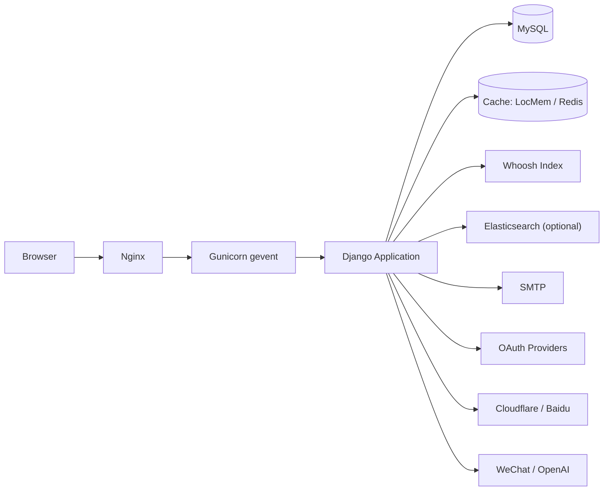
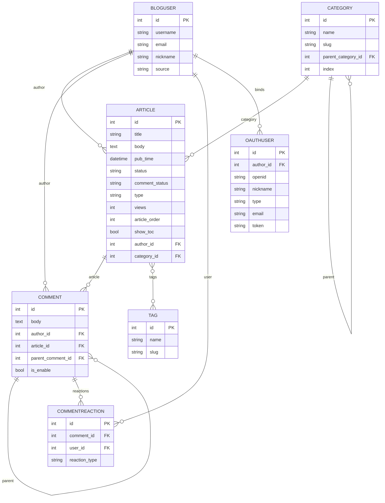

# DjangoBlog 项目技术分析（完整版）

> 分析对象：`/Users/meiling/PycharmProjects/DjangoBlog`
> 技术基线：Django 5.2.18、Python 3.10+（Docker 使用 3.11）、MySQL、Haystack 3.4.0
> 说明：结论来自静态阅读；示例中的域名与凭据均为占位符。

## 1. 项目概览

DjangoBlog 是一个基于 Django 的服务端渲染博客/CMS，具备以下能力：

- Markdown 写作（django-mdeditor + Pygments 代码高亮 + TOC）
- 文章、分类（支持父子层级）、标签、独立页面、友情链接、自定义侧边栏
- 多用户与作者主页、邮箱注册激活、找回密码
- 评论与二级回复、评论 Emoji 反应、评论审核开关
- 第三方登录（微博、Google、GitHub、Facebook、QQ）与邮箱绑定
- 全文检索（Whoosh + jieba 或 Elasticsearch 8 + IK）
- 插件系统（8 个内置插件，支持位置挂载与内容过滤器）
- 三语国际化（en / zh-hans / zh-hant）、RSS、Sitemap、百度推送
- 前端 Alpine.js + Tailwind CSS + HTMX + Vite 构建
- Docker / Kubernetes 部署，Gunicorn(gevent) + Nginx

关键入口：

| 入口 | 说明 |
| --- | --- |
| `manage.py` | 管理命令入口 |
| `djangoblog/settings.py` | 全站配置（462 行） |
| `djangoblog/urls.py` | 根路由，`i18n_patterns` 包裹业务路由 |
| `djangoblog/wsgi.py` | WSGI 入口，Gunicorn 加载 |
| `djangoblog/apps.py` | 启动时加载插件系统 |

## 2. 技术栈

### 2.1 后端依赖（requirements.txt）

| 组件 | 版本 | 用途 |
| --- | --- | --- |
| Django | 5.2.18 | Web 框架 |
| django-haystack | 3.4.0 | 搜索抽象层 |
| Whoosh | 2.7.4 | 默认搜索引擎 |
| jieba | 0.42.1 | 中文分词（Whoosh 后端） |
| elasticsearch / elasticsearch-dsl | 8.19.3 / 8.11.0 | 可选 ES 搜索与性能日志 |
| django-mdeditor | 0.1.20 | Markdown 编辑器 |
| Markdown | 3.11.2 | Markdown 渲染 |
| Pygments | 2.21.0 | 代码高亮 |
| nh3 | 0.3.7 | HTML 白名单净化（防 XSS） |
| django-compressor | 4.6.0 | 生产静态资源压缩 |
| django-uuslug | 2.0.0 | 中文标题转 slug |
| django-ipware / user-agents | 7.0.1 / 2.2.0 | 客户端 IP 与 UA 解析 |
| Pillow | 13.0.0 | 图片压缩、头像处理 |
| WeRoBot | 1.13.1 | 微信公众号机器人 |
| openai | 2.54.0 | AI 接口（servermanager） |
| redis | 7.4.1 | Redis 缓存客户端 |
| gevent / greenlet | 26.9.0 / 3.5.6 | Gunicorn 协程 worker |

注意：`djangoblog/__init__.py` 使用 `pymysql.install_as_MySQLdb()`，但 `pymysql` 未写入 `requirements.txt`，全新环境安装后启动会 `ModuleNotFoundError`。

### 2.2 前端依赖（frontend/package.json）

| 组件 | 版本 | 用途 |
| --- | --- | --- |
| Alpine.js | ^3.17.5 | 轻量响应式交互 |
| @alpinejs/focus、intersect、collapse | ^3.17.5 | 焦点管理、滚动监听、折叠 |
| Tailwind CSS | ^3.4.1 | 原子化样式 |
| @tailwindcss/typography | ^0.5.20 | 文章排版 |
| htmx.org | ^2.0.11 | `hx-boost` 局部换页 |
| Vite | ^2.9.0 | 构建与开发服务器 |
| terser、cssnano | ^5.51.2 / ^7.1.9 | 极限压缩 |

构建产物输出到 `blog/static/blog/dist`，通过 manifest 由 `vite_tags.py` 注入模板。

## 3. 系统架构

### 3.1 组件视图



### 3.2 App 职责

| App | 职责 | 关键文件 |
| --- | --- | --- |
| `blog` | 文章、分类、标签、友链、侧边栏、站点配置、搜索视图、插件钩子调用 | `models.py`、`views.py`、`urls.py`、`context_processors.py`、`middleware.py` |
| `accounts` | 自定义用户、注册/登录/登出、找回密码、邮箱或用户名登录后端 | `models.py`、`views.py`、`user_login_backend.py` |
| `comments` | 评论、二级回复、Emoji 反应、评论邮件 | `models.py`、`views.py`、`utils.py` |
| `oauth` | 第三方登录、邮箱补录与绑定 | `views.py`、`oauthmanager.py` |
| `servermanager` | 命令管理、邮件发送日志、微信公众号、AI 接口 | `models.py`、`robot.py`、`api/` |
| `djangoblog` | 全局配置、URL、缓存/签名/邮件工具、Mixin、基类视图、信号、插件引擎、搜索后端、站点地图、RSS | `settings.py`、`utils.py`、`mixins.py`、`base_views.py`、`blog_signals.py`、`plugin_manage/` |
| `plugins` | 8 个可插拔功能插件 | 各插件 `plugin.py` |
| `frontend` | Vite 前端工程 | `src/main.js`、`components/` |

### 3.3 中间件（按执行顺序）

| 中间件 | 作用 |
| --- | --- |
| `SecurityMiddleware` | 安全响应头 |
| `SessionMiddleware` | 会话 |
| `LocaleMiddleware` | 多语言识别 |
| `GZipMiddleware` | 响应压缩 |
| `CommonMiddleware` | URL 规范化、APPEND_SLASH |
| `CsrfViewMiddleware` | CSRF 校验 |
| `AuthenticationMiddleware` | 注入 `request.user` |
| `MessageMiddleware` | 消息框架 |
| `XFrameOptionsMiddleware` | 点击劫持防护（`SAMEORIGIN`） |
| `ConditionalGetMiddleware` | ETag/Last-Modified |
| `blog.middleware.OnlineMiddleware` | 统计页面渲染耗时，替换模板占位符 `<!!LOAD_TIMES!!>`；启用 ES 时写入 `performance` 索引 |

### 3.4 上下文处理器

`blog.context_processors.seo_processor` 为所有模板注入（缓存 10 小时）：

`SITE_NAME`、`SITE_DESCRIPTION`、`SITE_SEO_DESCRIPTION`、`SITE_KEYWORDS`、`SITE_BASE_URL`、`ARTICLE_SUB_LENGTH`、`nav_category_list`、`nav_pages`、`OPEN_SITE_COMMENT`、`BEIAN_CODE`、`ANALYTICS_CODE`、`SHOW_GONGAN_CODE`、`BEIAN_CODE_GONGAN`、`GLOBAL_HEADER`、`GLOBAL_FOOTER`、`COMMENT_NEED_REVIEW`、`COLOR_SCHEME`、`CURRENT_YEAR`、`SHOW_GOOGLE_ADSENSE`、`GOOGLE_ADSENSE_CODES`。

### 3.5 信号

`djangoblog/blog_signals.py` 注册了全局 `post_save` 接收器：

- 仅更新 `views` 时直接返回（避免浏览量触发缓存清理与推送）
- 实例带 `get_full_url()` 时触发百度推送（测试环境跳过）
- `Comment` 保存：过期文章页缓存、清理评论缓存、侧边栏与 SEO 缓存，线程内发送评论邮件
- `Article` 保存：清理 `index_1`、当前文章评论缓存、分类/标签/作者首页缓存、`archives`、侧边栏、SEO 缓存
- `Category` / `Tag` 保存：清理对应列表首页缓存
- 登录/登出：清理侧边栏缓存

自定义信号：`oauth_user_login_signal`（OAuth 登录后本地化头像）、`send_email_signal`（统一邮件发送并写 `EmailSendLog`）。

## 4. 数据模型

### 4.1 ER 图



### 4.2 核心模型字段

**Article（文章/独立页面）**

| 字段 | 类型 | 说明 |
| --- | --- | --- |
| `title` | CharField(200, unique) | 标题 |
| `body` | MDTextField | Markdown 正文 |
| `pub_time` | DateTime | 发布时间，默认当前 |
| `status` | Char(1) | `d` 草稿 / `p` 已发布 |
| `comment_status` | Char(1) | `o` 开启 / `c` 关闭 |
| `type` | Char(1) | `a` 文章 / `p` 独立页面 |
| `views` | PositiveInteger | 浏览量 |
| `author` | FK(BlogUser) | 作者 |
| `article_order` | Integer | 置顶权重，默认 0 |
| `show_toc` | Boolean | 是否显示目录 |
| `category` | FK(Category) | 分类 |
| `tags` | M2M(Tag) | 标签 |

行为：

- `Meta.ordering = ['-article_order', '-pub_time']`
- 4 个组合索引：`(type,status,-pub_time)`、`(status,-views)`、`(author,status,type)`、`(category,status)`
- `get_absolute_url()` 使用 `creation_time` 的年月日拼 URL，而不是 `pub_time`
- `viewed()` 通过 `save(update_fields=['views'])` 自增
- `next_article` / `prev_article` / `comment_list` / `get_category_tree` 有缓存

**Category / Tag**

| 模型 | 字段 | 说明 |
| --- | --- | --- |
| Category | `name`(unique)、`parent_category`(自关联)、`slug`、`index` | 支持无限层级；`get_sub_categorys()` 递归收集子分类 |
| Tag | `name`(unique)、`slug` | `get_article_count()` 统计已发布文章数 |

**Comment / CommentReaction**

| 字段 | 说明 |
| --- | --- |
| `Comment.body` | TextField(max_length=300)（数据库层不限制长度） |
| `Comment.author` / `article` / `parent_comment` | 作者、文章、父评论（二级回复） |
| `Comment.is_enable` | 默认 False，需审核；站点关闭审核时提交即 True |
| `CommentReaction.reaction_type` | 8 种 Emoji：👍 👎 ❤️ 😄 🎉 😕 🚀 👀 |
| `unique_together` | `(comment, user, reaction_type)`，同一用户同一表情只能一次 |

**BlogSettings（站点配置，单例）**

站点名称/描述/SEO、摘要长度、侧边栏数量、评论分页数量、AdSense、全站评论开关、配色方案（8 种）、公共头尾 HTML、备案号、统计代码、评论审核开关。`clean()` 保证只有一条记录，`save()` 会 `cache.clear()`。

**BlogUser**

继承 `AbstractUser`，扩展 `nickname`、`source`（Register / authorize / emailconfirm）、创建与修改时间。`AUTH_USER_MODEL='accounts.BlogUser'`。

**OAuthUser / OAuthConfig**

`OAuthUser` 保存 openid、nickname、token、picture、type、email、metadata 与绑定用户；`OAuthConfig` 保存各平台 AppKey/AppSecret/回调地址，`clean()` 保证同类型唯一。

**Links / SideBar**

友链：`name`(unique)、`link`、`sequence`(unique)、`is_enable`、`show_type`（i 首页 / l 列表 / p 文章 / a 全部 / s 幻灯片）。侧边栏：`name`、`content`（HTML）、`sequence`、`is_enable`。

**servermanager**

`commands`（命令模板）、`EmailSendLog`（收件人、标题、内容、发送结果）。

## 5. HTTP 接口清单

### 5.1 全局路由（不受语言前缀影响）

| 方法 | 路径 | 名称 | 视图 | 权限 | 说明 |
| --- | --- | --- | --- | --- | --- |
| GET | `/health/` | `health_check` | `health_check` | 公开 | 返回 `{"status":"healthy","timestamp":...}` |
| POST | `/i18n/setlang/` | Django 内置 | `set_language` | 公开 | 切换语言，参数 `language`、`next` |

### 5.2 blog 应用

路由被 `i18n_patterns` 包裹，默认语言（zh-hans）无前缀，`/en/`、`/zh-hant/` 有前缀。

| 方法 | 路径 | 名称 | 视图 | 说明 |
| --- | --- | --- | --- | --- |
| GET | `/` | `blog:index` | `IndexView` | 首页文章流，仅 `type=a,status=p` |
| GET | `/page/<int:page>/` | `blog:index_page` | `IndexView` | 首页分页 |
| GET | `/article/<year>/<month>/<day>/<id>.html` | `blog:detailbyid` | `ArticleDetailView` | 文章详情，日期段取自 `creation_time` |
| GET | `/category/<slug>.html` | `blog:category_detail` | `CategoryDetailView` | 分类文章列表（含子分类） |
| GET | `/category/<slug>/<int:page>.html` | `blog:category_detail_page` | `CategoryDetailView` | 分类分页 |
| GET | `/author/<name>.html` | `blog:author_detail` | `AuthorDetailView` | 作者文章列表 |
| GET | `/author/<name>/<int:page>.html` | `blog:author_detail_page` | `AuthorDetailView` | 作者分页 |
| GET | `/tag/<slug>.html` | `blog:tag_detail` | `TagDetailView` | 标签文章列表 |
| GET | `/tag/<slug>/<int:page>.html` | `blog:tag_detail_page` | `TagDetailView` | 标签分页 |
| GET | `/archives.html` | `blog:archives` | `ArchivesView` | 归档，`cache_page(3600)` |
| GET | `/links.html` | `blog:links` | `LinkListView` | 友链，仅 `is_enable=True` |
| POST | `/upload?sign=...` | `blog:upload` | `fileupload` | 图床，`csrf_exempt`，签名校验 |
| GET | `/clean` | `blog:clean` | `clean_cache_view` | 清空全站缓存，无鉴权 |

### 5.3 accounts 应用

`app_name='accounts'`，根路由 `namespace='account'`，两个命名空间均可反向解析。

| 方法 | 路径 | 名称 | 视图 | 说明 |
| --- | --- | --- | --- | --- |
| GET/POST | `/login/` | `account:login` | `LoginView` | 用户名或邮箱登录，`remember` 控制 30 天/2 周 |
| GET/POST | `/register/` | `account:register` | `RegisterView` | 注册，创建 `is_active=False` 用户并发激活邮件 |
| GET | `/logout/` | `account:logout` | `LogoutView` | 登出并跳转 `/login/`，删除 `logged_user` cookie |
| GET | `/account/result.html` | `account:result` | `account_result` | `type=register` 提示；`type=validation&id=&sign=` 激活账号 |
| GET/POST | `/forget_password/` | `account:forget_password` | `ForgetPasswordView` | 校验邮箱验证码后重置密码 |
| POST | `/forget_password_code/` | `account:forget_password_code` | `ForgetPasswordEmailCode` | 发送 6 位验证码（缓存 5 分钟） |

### 5.4 comments 应用

| 方法 | 路径 | 名称 | 视图 | 权限 | 说明 |
| --- | --- | --- | --- | --- | --- |
| GET | `/article/<id>/postcomment` | `comment:postcomment` | `CommentPostView` | 登录 | 直接跳转到文章评论区 |
| POST | `/article/<id>/postcomment` | 同上 | 同上 | 登录 + CSRF | 字段 `body`、`parent_comment_id` |
| GET | `/comment/<id>/react` | `comment:comment_react` | `CommentReactionView.get` | 公开 | 返回 Emoji 统计 JSON |
| POST | `/comment/<id>/react` | 同上 | `CommentReactionView.post` | 登录 + CSRF | 字段 `reaction_type`，切换点赞 |

### 5.5 oauth 应用

| 方法 | 路径 | 名称 | 说明 |
| --- | --- | --- | --- |
| GET | `/oauth/oauthlogin?type=github&next_url=/` | `oauth:oauthlogin` | 跳转到第三方授权页 |
| GET | `/oauth/authorize?type=github&code=...` | 无 | 授权回调，换取 token、登录或跳转补录邮箱 |
| GET/POST | `/oauth/requireemail/<oauthid>.html` | `oauth:require_email` | 补录邮箱并发送绑定邮件 |
| GET | `/oauth/emailconfirm/<id>/<sign>.html` | `oauth:email_confirm` | 校验签名、绑定并登录 |
| GET | `/oauth/bindsuccess/<oauthid>.html` | `oauth:bindsuccess` | 绑定结果页，`type=email/success` |

`type` 取值：`weibo`、`google`、`github`、`facebook`、`qq`。

### 5.6 其他

| 方法 | 路径 | 说明 |
| --- | --- | --- |
| GET | `/search?q=关键词&page=1` | Haystack 搜索，`EsSearchView` 开启高亮 |
| GET | `/feed/`、`/rss/` | `DjangoBlogFeed` RSS |
| GET | `/sitemap.xml` | 文章/分类/标签/用户/静态页站点地图 |
| GET/POST | `/robot` | WeRoBot 微信机器人（GET 验证，POST 消息） |
| GET | `/mdeditor/...` | django-mdeditor 图片/文件上传接口 |
| GET/POST | `/admin/...` | 自定义 AdminSite，仅 superuser |
| GET | `/static/...`、`/media/...` | 静态与媒体文件（媒体仅 DEBUG） |

### 5.7 签名规则

| 场景 | 计算方式 |
| --- | --- |
| 注册激活 | `HMAC_SHA256(SECRET_KEY, HMAC_SHA256(SECRET_KEY, SECRET_KEY + user.id))` |
| OAuth 邮箱绑定 | `HMAC_SHA256(SECRET_KEY, SECRET_KEY + oauthuser.id + SECRET_KEY)`，比较时忽略大小写 |
| 图床上传 | `HMAC_SHA256(SECRET_KEY, HMAC_SHA256(SECRET_KEY, SECRET_KEY))`，作为 `?sign=` |

其中 `HMAC_SHA256(key, msg)` 为 `hmac.new(key.encode(), msg.encode(), hashlib.sha256).hexdigest()`。

## 6. 页面与功能

### 6.1 页面路由与模板

| 页面 | 路由 | 模板 | 主要功能 |
| --- | --- | --- | --- |
| 首页 | `/`、`/page/N/` | `blog/article_index.html` | 文章卡片流、分页、侧边栏、首页友链 |
| 文章详情 | `/article/...html` | `blog/article_detail.html` | 正文、TOC、插件位、评论、上下篇、面包屑 |
| 分类 | `/category/<slug>.html` | `article_index.html` | 当前分类及子分类文章 |
| 作者 | `/author/<name>.html` | `article_index.html` | 作者已发布文章 |
| 标签 | `/tag/<slug>.html` | `article_index.html` | 标签文章，侧边栏标签云 |
| 归档 | `/archives.html` | `blog/article_archives.html` | 按年月分组的时间线 |
| 友链 | `/links.html` | `blog/links_list.html` | 启用中的友链卡片 |
| 搜索 | `/search` | `search/search.html` | 关键词、结果高亮、分页、拼写建议 |
| 登录 | `/login/` | `account/login.html` | 账号密码、密码显隐、记住我、OAuth 入口 |
| 注册 | `/register/` | `account/registration_form.html` | 用户名/邮箱/双密码 |
| 找回密码 | `/forget_password/` | `account/forget_password.html` | 邮箱 + 验证码 + 新密码 |
| 注册结果 | `/account/result.html` | `account/result.html` | 注册成功/邮箱验证结果 |
| OAuth 补录邮箱 | `/oauth/requireemail/<id>.html` | `oauth/require_email.html` | 展示头像与邮箱表单 |
| 绑定结果 | `/oauth/bindsuccess/<id>.html` | `oauth/bindsuccess.html` | 绑定提示 |
| 错误页 | 404/500/403 | `djangoblog/error_views.py` 对应模板 | 自定义错误页 |

### 6.2 公共布局 `templates/share_layout/base.html`

- SEO：`seo_title`、`seo_description`、`seo_keywords`、Open Graph、JSON-LD
- 防闪烁主题脚本：读取 `localStorage['dark-mode-enabled']`，暴露 `window.themeManager`
- 资源：Vite manifest 注入 CSS/JS，`head_resources`/`body_resources` 插件钩子
- 导航：`nav.html` 输出分类树与独立页面
- 页脚：`footer.html` 输出备案号、公安备案、统计代码、公共尾部 HTML、加载耗时
- 交互：HTMX `hx-boost` 替换 `#main`；MathJax 延迟加载；回到顶部；图片灯箱；代码复制
- 全局头尾：`GLOBAL_HEADER`、`GLOBAL_FOOTER` 原样渲染（管理员可控）

### 6.3 文章卡片与详情

- 卡片 `templates/blog/tags/article_info.html`：标题、作者、分类、发布时间、浏览量、标签、摘要、首图
- 详情页：面包屑（模板片段缓存 `breadcrumb_v3` 36000 秒）、标题元信息、TOC（`show_toc`）、正文
- 正文渲染链：Markdown → `sanitize_html`（nh3 白名单）→ `the_content` 过滤器（插件）→ 模板输出
- 插件位置：`article_top`、`article_bottom`、`comment_before`、`comment_after`
- 评论：父评论分页（`comment_page`），子评论内嵌；Emoji 反应条；审核提示
- 上下篇：`next_article` / `prev_article`（缓存 10 小时）

### 6.4 侧边栏 `templates/blog/tags/sidebar.html`

由 `` 渲染，整块缓存 648000 秒（7.5 天），包含：

- 站点公告（`SideBar`，按 `sequence` 排序）
- 热门文章（按 `views`）
- 最新评论（`is_enable=True`）
- 标签云（含文章数）
- 最新文章
- GitHub 入口等静态块
- 插件侧边栏组件（`sidebar` 位置）

### 6.5 前端组件（frontend/src/components）

| 组件 | 作用 |
| --- | --- |
| `backToTop.js` | 回到顶部，滚动阈值显隐 |
| `codeCopy.js` | 代码块复制按钮 |
| `commentSystem.js` | 评论区交互、分页、回复 |
| `legacyComments.js` | 兼容旧版评论回复 |
| `imageLightbox.js` | 正文图片灯箱 |
| `navigation.js` | 移动端导航、下拉菜单 |
| `reactionPicker.js` | Emoji 反应选择与提交 |

`main.js` 还负责：注册 Alpine 插件、初始化暗色模式、NProgress、HTMX 配置与 `afterSwap` 滚动复位。

## 7. 插件系统

### 7.1 机制

- `djangoblog/plugin_manage/loader.py` 在 `DjangoblogAppConfig.ready()` 中按 `ACTIVE_PLUGINS` 导入 `plugins/<name>/plugin.py`
- 每个插件继承 `BasePlugin`，在 `register_hooks()` 中注册：
  - Action Hook：`hooks.register(name, func)` + `hooks.run_action(name, **kwargs)`
  - Filter Hook：`hooks.apply_filters(name, value, **kwargs)`
- 异常隔离：单个插件抛错只记录日志，不阻断主流程
- 位置钩子：`SUPPORTED_POSITIONS` + `render_<position>_widget()`，按 `priority` 排序输出
- 资源注入：`get_critical_head_html()`、`get_head_html()`、`get_body_html()`、`get_css_files()`、`get_js_files()`

### 7.2 钩子常量

| 常量 | 值 | 类型 |
| --- | --- | --- |
| `ARTICLE_CONTENT_HOOK_NAME` | `the_content` | Filter |
| `ARTICLE_DETAIL_LOAD` | `article_detail_load` | Action |
| `after_article_body_get` | 同名 | Action |
| `head_meta` | 同名 | Action/Filter |
| `POSITION_HOOKS` | `article_top`、`article_bottom`、`sidebar`、`header`、`footer`、`comment_before`、`comment_after` | 位置 |
| `HEAD_RESOURCES_HOOK` / `BODY_RESOURCES_HOOK` | `head_resources` / `body_resources` | 资源注入 |

### 7.3 内置插件

| 插件 | 挂载点 | 功能 |
| --- | --- | --- |
| `view_count` | `after_article_body_get` | 每次详情渲染 `article.viewed()`，浏览量 +1（无去重） |
| `article_copyright` | `the_content` | 文末追加版权声明 |
| `reading_time` | `the_content` | 按 200 字/分钟估算阅读时间，摘要模式跳过 |
| `external_links` | `the_content` | 外链加 `target=_blank` 与 `rel=nofollow` |
| `image_lazy_loading` | `the_content` | 图片加 `loading=lazy`、`decoding=async` |
| `seo_optimizer` | `head_meta` | 生成/补全 SEO meta |
| `article_recommendation` | `article_detail_load` + `article_bottom` | 相关文章推荐 |
| `cloudflare_cache` | 文章保存信号 | 清理 Cloudflare 缓存 |

## 8. 搜索子系统

### 8.1 双轨结构

| 模式 | 触发条件 | 组件 |
| --- | --- | --- |
| Whoosh（默认） | 未设置 `DJANGO_ELASTICSEARCH_HOST` | `djangoblog/whoosh_cn_backend.py` + jieba 分词 + `blog/search_indexes.py` |
| Elasticsearch | 设置 `DJANGO_ELASTICSEARCH_HOST` | `djangoblog/elasticsearch_backend.py` + `blog/documents.py`（IK 分词） |

Haystack 配置：

```python
HAYSTACK_CONNECTIONS = {
    'default': {'ENGINE': 'djangoblog.whoosh_cn_backend.WhooshEngine',
                'PATH': BASE_DIR / 'whoosh_index'}
}
HAYSTACK_SIGNAL_PROCESSOR = 'haystack.signals.RealtimeSignalProcessor'
```

### 8.2 索引定义

- `ArticleIndex`：`text`（模板 `search/indexes/blog/article_text.txt`）、`title`、`body`，仅索引 `status='p'`
- `ArticleDocument`（ES）：`blog` 索引，`body/title/author/category/tags` 使用 `ik_max_word` 索引、`ik_smart` 搜索
- `ElapsedTimeDocument`（ES）：`performance` 索引，记录 URL、耗时、IP、GeoIP、UA

### 8.3 查询与展示

- 路由：`/search` → `EsSearchView`（继承 Haystack `SearchView`）
- `build_form()` 对 `SearchQuerySet` 调用 `.highlight()`
- 模板：`templates/search/search.html`，分页参数 `page`
- 结果对象由 `templates/search/indexes/blog/` 下的索引模板渲染

### 8.4 索引命令与缺陷

- `python manage.py build_index`：**仅在启用 ES 时生效**（重建 `performance`，删除并重建 `blog`）
- Whoosh 模式应使用 `python manage.py rebuild_index`，但 Docker `entrypoint.sh` 调用的是 `build_index`，因此容器内 Whoosh 索引不会被重建
- `blog/apps.py` 启动时只做存在性检查，不建索引
- 仓库内提交了 `whoosh_index/MAIN_WRITELOCK`，多进程/只读文件系统下可能报锁错误

## 9. 缓存与性能

### 9.1 缓存后端

```python
CACHES = {'default': {'BACKEND': 'django.core.cache.backends.locmem.LocMemCache',
                      'TIMEOUT': 10800, 'LOCATION': 'unique-snowflake'}}
```

设置 `DJANGO_REDIS_URL=host:port` 时切换为 `RedisCache`（注意代码会拼 `redis://` 前缀）。

### 9.2 缓存键与 TTL

| 键 | 内容 | TTL | 失效方式 |
| --- | --- | --- | --- |
| `index_{page}` | 首页 QuerySet | 默认 3 小时（LocMem） | Article 保存只清 `index_1` |
| `category_list_{name}_{page}` | 分类列表 | 默认 | 只清 `_1` |
| `tag_{name}_{page}` | 标签列表 | 默认 | 只清 `_1` |
| `author_{slug}_{page}` | 作者列表 | 默认 | 只清 `_1` |
| `archives` | 归档 QuerySet | 默认 | Article 保存清理 |
| `article_comments_{id}` | 文章评论 | 10 小时 | Comment 保存清理 |
| `get_blog_setting` | 站点配置 | 默认 | `BlogSettings.save()` 全清 |
| `seo_processor` | 全站上下文 | 10 小时 | 文章/分类/评论保存清理 |
| `sidebar{i,l,p,a,s}` | 侧边栏数据 | 648000 秒 | 文章/评论/分类/标签保存、登录登出 |
| `breadcrumb_v3`（模板片段） | 面包屑 | 36000 秒 | 无主动清理 |
| `avatar/{email}` | 头像地址 | 24 小时 | 到期 |
| `cache_decorator` 哈希键 | 上下篇、分类树、标签计数 | 10 小时 | 只能 `cache.clear()` |
| `/archives.html` HTTP 缓存 | 整页 | 3600 秒 | 到期 |

### 9.3 性能优化点

- `OptimizedArticleQueryMixin`：`select_related('author','category')` + `prefetch_related('tags')`
- 详情页评论：父评论 `select_related('author')` + `prefetch_related('comment_set__author')`
- Article 4 个组合索引、Comment 2 个组合索引、CommentReaction 1 个索引
- `SlugCachedMixin`：同请求内分类/标签只查一次
- 生产启用 `ManifestStaticFilesStorage` + Compressor 压缩
- 本地内存缓存不适合多 worker；生产建议 Redis

## 10. 安全设计

| 机制 | 实现 |
| --- | --- |
| CSRF | 全局中间件；`SecureFormView`、`AuthenticatedFormView`、`LoginFormView` 显式 `csrf_protect` |
| 登录保护 | `login_required`；`LOGIN_URL='/login/'` |
| 敏感参数 | `sensitive_post_parameters('password')`，异常日志脱敏 |
| 禁止缓存 | 登录/登出视图 `never_cache` |
| 开放重定向 | 登录与 OAuth 使用 `url_has_allowed_host_and_scheme` 校验 `next` |
| XSS | Markdown 渲染后经 `sanitize_html`（nh3 标签/属性/协议白名单） |
| 上传路径 | `os.path.normpath` + `startswith(base_dir)` 防目录穿越 |
| 邮件/绑定签名 | HMAC-SHA256 |
| Admin | 自定义 `AdminSite`，仅 superuser 可访问 |
| 点击劫持 | `X_FRAME_OPTIONS='SAMEORIGIN'` |
| 微信 | WeRoBot 签名校验 |

需注意的薄弱点：

- `SECRET_KEY` 有硬编码兜底值，`ALLOWED_HOSTS=['*']`
- `/clean` 无鉴权
- `/upload` 的签名只由 `SECRET_KEY` 派生，且 `csrf_exempt`
- `OAuthUser.token`、`OAuthConfig.appsecret` 明文存储
- 评论关闭时抛 `ValidationError`，返回 500 而非 403

## 11. 通知与异步

| 能力 | 实现 |
| --- | --- |
| 邮件 | `send_email()` → `send_email_signal` → `EmailMultiAlternatives`（HTML）→ 写 `EmailSendLog` |
| 评论通知 | `Comment` 保存后 `_thread.start_new_thread(send_comment_email, ...)` |
| 百度推送 | `post_save` 中对带 `get_full_url()` 的实例调用 `SpiderNotify.baidu_notify`，URL 来自 `DJANGO_BAIDU_NOTIFY_URL` |
| Cloudflare | `cloudflare_cache` 插件在文章变更时调用 API 清缓存 |
| 微信 | `WeRoBot` + `servermanager/MemcacheStorage.py`（会话存 Django cache） |
| OpenAI | `servermanager/api/commonapi.py`，读取 `OPENAI_API_KEY` |
| 性能日志 | 启用 ES 时 `OnlineMiddleware` 写入 `performance` 索引（含 GeoIP pipeline） |

注意：`_thread` 方式无重试、无队列，进程重启会丢任务；邮件同步发送会阻塞请求。

## 12. 部署与运维

### 12.1 本地运行

```bash
python -m venv .venv && source .venv/bin/activate
pip install -r requirements.txt
# 需额外安装 pymysql
pip install pymysql
python manage.py migrate
python manage.py create_testdata      # 可选
python manage.py runserver
cd frontend && npm ci && npm run dev  # 前端热更新
```

要求本地 MySQL 的库名/账号与 `settings.py` 中硬编码值一致。

### 12.2 Docker

`Dockerfile` 两阶段：

1. `node:20-alpine`：`npm ci` + `npm run build`，产物在 `blog/static/blog/dist`
2. `python:3.11`：安装 `default-libmysqlclient-dev`、`gettext`，`pip install -r requirements.txt` 与 `gunicorn[gevent]`，复制代码与前端产物，入口 `deploy/entrypoint.sh`

`entrypoint.sh` 顺序：

```
makemigrations → migrate → collectstatic → 校验 dist/manifest
→ 复制 .vite 到 collectedstatic → compress --force
→ build_index → compilemessages → gunicorn(gevent, 1 worker, 4 threads, :8000)
```

`docker-compose.yml` 提供 MySQL、Redis 与应用；`docker-compose.es.yml` 追加 Elasticsearch 与 Memcached。

### 12.3 Kubernetes

`deploy/k8s/` 包含 `deployment`、`service`、`gateway`、`configmap`、`pv`、`pvc`、`storageclass`。探针使用 `/health/`。ConfigMap 注入了 `DJANGO_MYSQL_*`、`DJANGO_REDIS_URL`、`DJANGO_DEBUG`、`DJANGO_SECRET_KEY` 等。

**关键问题**：`settings.py` 的 `DATABASES` 完全硬编码，未读取 `DJANGO_MYSQL_*`，因此在 Docker/K8s 中仍会连接 `127.0.0.1:3306` 的 `root/luoluo123`。

### 12.4 环境变量

| 变量 | 作用 | 默认 |
| --- | --- | --- |
| `DJANGO_SECRET_KEY` | 密钥 | 内置兜底值 |
| `DJANGO_DEBUG` | 调试开关 | `True` |
| `DJANGO_MYSQL_DATABASE/USER/PASSWORD/HOST/PORT` | 数据库 | **未生效** |
| `DJANGO_REDIS_URL` | Redis 地址（host:port） | 未设置则 LocMem |
| `DJANGO_ELASTICSEARCH_HOST` | ES 地址 | 未设置则 Whoosh |
| `ELASTICSEARCH_VERIFY_CERTS/USERNAME/PASSWORD/API_KEY/CA_CERTS/CLIENT_CERT/CLIENT_KEY` | ES 认证 | 无 |
| `DJANGO_EMAIL_HOST/PORT/USER/PASSWORD` | SMTP | `smtp.mxhichina.com:465` |
| `DJANGO_EMAIL_TLS` / `DJANGO_EMAIL_SSL` | 邮件加密 | `False` / `True` |
| `DJANGO_ADMIN_EMAIL` | 管理员邮箱 | `admin@admin.com` |
| `DJANGO_BAIDU_NOTIFY_URL` | 百度推送地址 | 作者站点默认值 |
| `DJANGO_WXADMIN_PASSWORD` | 微信后台密码（双重 MD5） | 内置值 |
| `COMPRESS_OFFLINE` | 是否离线压缩 | `False` |
| `OPENAI_API_KEY` / `HTTP_PROXY` | AI 接口 | 无 |

### 12.5 管理命令

| 命令 | 作用 |
| --- | --- |
| `build_index` | 仅 ES 模式有效：建 `performance`、重建 `blog` |
| `rebuild_index` / `update_index` | Haystack 自带，Whoosh 模式使用 |
| `build_search_words` | 构建搜索词 |
| `clear_cache` | 清缓存 |
| `create_testdata` | 生成测试数据 |
| `ping_baidu` | 手动推送 URL |
| `sync_user_avatar` | 同步 OAuth 头像 |

## 13. 测试与 CI

测试文件按模块划分：

- `blog/`：`test_views.py`、`test_admin.py`、`test_article_business_logic.py`、`test_context_processors.py`、`test_middleware.py`、`test_templatetags.py`
- `accounts/`：`test_admin.py`、`test_user_business_logic.py`
- `comments/`：`test_views.py`、`test_comment_business_logic.py`
- `oauth/`：`test_oauth_business_logic.py`
- `djangoblog/`：`test_base.py`、`test_plugins.py`、`test_email_integration*.py`

运行：

```bash
python manage.py test
coverage run manage.py test && coverage report
```

CI 位于 `.github/workflows/`，根目录提供 `codecov.yml`；依赖自动更新由 `.github/dependabot.yml` 负责。

## 14. 已知问题与技术债

| # | 级别 | 位置 | 问题 | 建议 |
| --- | --- | --- | --- | --- |
| 1 | P0 | `settings.py:108` | 数据库连接硬编码，`DJANGO_MYSQL_*` 未生效，容器部署连不上库 | 改为读取环境变量 |
| 2 | P0 | `djangoblog/__init__.py` | 导入 `pymysql` 但依赖未声明 | 加入 requirements 或改用 mysqlclient |
| 3 | P0 | `blog/views.py` `/clean` | 任意人可清空全站缓存 | 加 superuser 或签名校验 |
| 4 | P1 | `blog/views.py` `/upload` | 签名由 SECRET_KEY 派生；无大小/类型限制；写入根 `static/` 不在收集范围；返回绝对路径 | 改用对象存储/媒体目录，限制类型大小 |
| 5 | P1 | `servermanager/api/commonapi.py` | `openai.ChatCompletion.create` 与 openai 2.x 不兼容 | 迁移到 `client.chat.completions.create` |
| 6 | P1 | `servermanager/api/commonapi.py` | `os.popen` 执行命令 | 白名单 + 参数化，禁用 shell |
| 7 | P1 | `comments/views.py` | 评论关闭时 `raise ValidationError` → 500；`status=='c'` 为死条件 | 返回 403 或表单错误 |
| 8 | P1 | `comments/views.py` | `form_invalid` 仅传 `form/article` 渲染详情页，上下文缺失易 500 | 复用详情页上下文或返回 400 |
| 9 | P1 | `accounts/views.py` | 同时使用 `account:` 与 `accounts:` 命名空间 | 统一命名空间 |
| 10 | P2 | `djangoblog/urls.py:43` | `handle403` 拼写错误，403 处理器未注册 | 改为 `handler403` |
| 11 | P2 | `blog/views.py:53` | `self.request.get['pages']` 会 KeyError（当前未被调用） | 删除或改为 `GET.get` |
| 12 | P2 | `blog_signals.py` | 文章保存只清第 1 页缓存，第 2 页起长期脏数据 | 按前缀批量失效或缩短 TTL |
| 13 | P2 | `blog/models.py` | 上下篇/标签计数使用哈希缓存键，无法定向失效 | 改用 `CacheKey` 显式键 |
| 14 | P2 | `blog_signals.py` | `expire_view_cache(key_prefix='blogdetail')` 无对应 `cache_page`，实为空操作 | 删除或真正缓存详情页 |
| 15 | P2 | `blog/management/commands/build_index.py` | Whoosh 模式不建索引，容器启动实际未重建 | 调用 `rebuild_index` |
| 16 | P2 | `whoosh_index/` | `MAIN_WRITELOCK` 等索引文件入库 | 加入 `.gitignore`，运行时生成 |
| 17 | P2 | `comments/admin.py` | `CommentReaction` 注册在默认 `admin.site`，自定义后台不可见 | 注册到 `admin_site` |
| 18 | P2 | `settings.py:435` | `STATICFILES_STORAGE` 在 Django 5.1+ 已弃用 | 迁移到 `STORAGES` |
| 19 | P2 | `frontend/vite.config.cjs` | postcss 指向 `./postcss.config.js`，实际文件为 `.cjs` | 修正路径 |
| 20 | P3 | `accounts/models.py` | `email` 非唯一，找回密码 `.filter().get()` 可能多结果异常 | 加唯一约束并处理重复 |
| 21 | P3 | `comments/models.py` | `TextField(max_length=300)` 不产生数据库约束 | 在表单/模型 `clean` 校验 |
| 22 | P3 | `oauth/` | `token`、`appsecret` 明文存储 | 加密存储或使用密钥管理 |
| 23 | P3 | `djangoblog/__init__.py` | `default_app_config` 自 Django 3.2 起无效 | 删除 |
| 24 | P3 | `settings.py` | 默认 RSS/推送地址、模板链接硬编码作者站点 | 改为配置项 |
| 25 | P3 | `blog/models.py` | `get_absolute_url` 用 `creation_time`，与 `pub_time` 语义不一致 | 统一为 `pub_time` |
| 26 | P3 | `blog/models.py` | 每次保存重新 slugify，改名后旧链接失效 | 仅在 slug 为空时生成 |
| 27 | P3 | `requirements.txt` | `django-echarts`、`pyecharts`、`prettytable` 未见使用 | 清理 |
| 28 | P3 | `blog/forms.py` | `BlogSearchForm` 未被使用 | 删除或接入 |
| 29 | P3 | 全局 | 登录、验证码、评论无频率限制 | 增加限流与验证码 |

## 15. 附录

### 15.1 关键文件索引

| 主题 | 文件 |
| --- | --- |
| 配置 | `djangoblog/settings.py` |
| 根路由 | `djangoblog/urls.py` |
| 自定义后台 | `djangoblog/admin_site.py`、`blog/admin.py`、`accounts/admin.py`、`comments/admin.py`、`oauth/admin.py`、`servermanager/admin.py` |
| 工具 | `djangoblog/utils.py`（签名、缓存装饰器、Markdown、净化、邮件） |
| 视图基类 | `djangoblog/base_views.py` |
| 查询 Mixin | `djangoblog/mixins.py` |
| 信号 | `djangoblog/blog_signals.py` |
| 插件引擎 | `djangoblog/plugin_manage/{loader,hooks,base_plugin,hook_constants}.py` |
| 搜索后端 | `djangoblog/whoosh_cn_backend.py`、`djangoblog/elasticsearch_backend.py` |
| 搜索索引 | `blog/search_indexes.py`、`blog/documents.py` |
| 模板标签 | `blog/templatetags/blog_tags.py`、`vite_tags.py`、`comments/templatetags/comments_tags.py` |
| 前端入口 | `frontend/src/main.js`、`frontend/vite.config.cjs` |
| 部署 | `Dockerfile`、`deploy/entrypoint.sh`、`deploy/nginx.conf`、`deploy/docker-compose/`、`deploy/k8s/` |

### 15.2 URL 名称速查

`blog:index`、`blog:index_page`、`blog:detailbyid`、`blog:category_detail`、`blog:category_detail_page`、`blog:author_detail`、`blog:author_detail_page`、`blog:tag_detail`、`blog:tag_detail_page`、`blog:archives`、`blog:links`、`blog:upload`、`blog:clean`、`account:login`、`account:register`、`account:logout`、`account:result`、`account:forget_password`、`account:forget_password_code`、`comment:postcomment`、`comment:comment_react`、`oauth:oauthlogin`、`oauth:require_email`、`oauth:email_confirm`、`oauth:bindsuccess`、`health_check`、`search`。