# DjangoBlog 架构与时序图

> 所有图使用 Mermaid，可在 GitHub、GitLab、Typora、VS Code 中直接渲染。

## 1. 部署拓扑

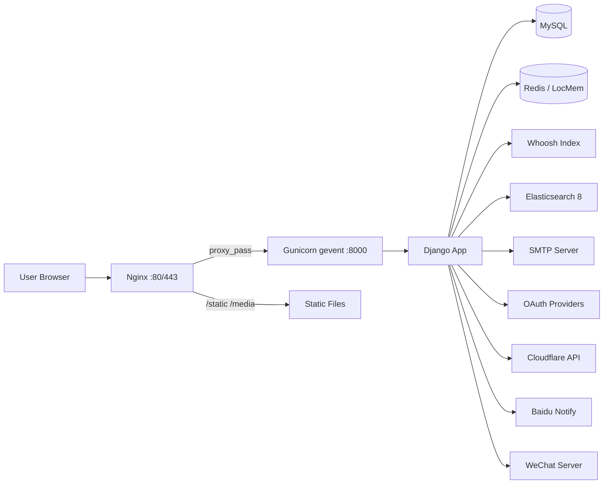

## 2. 请求生命周期

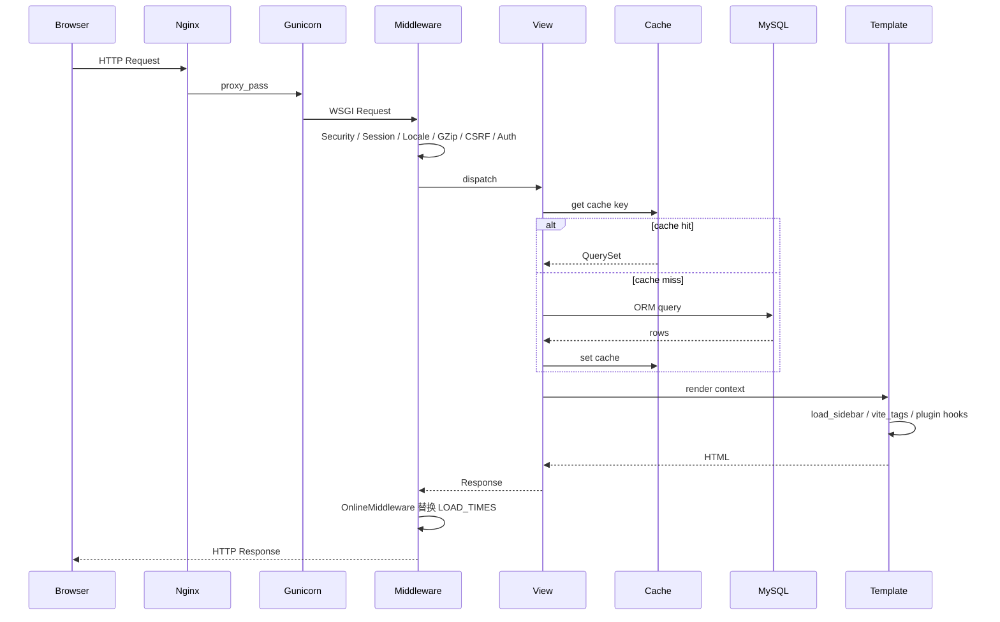

## 3. 文章详情页渲染

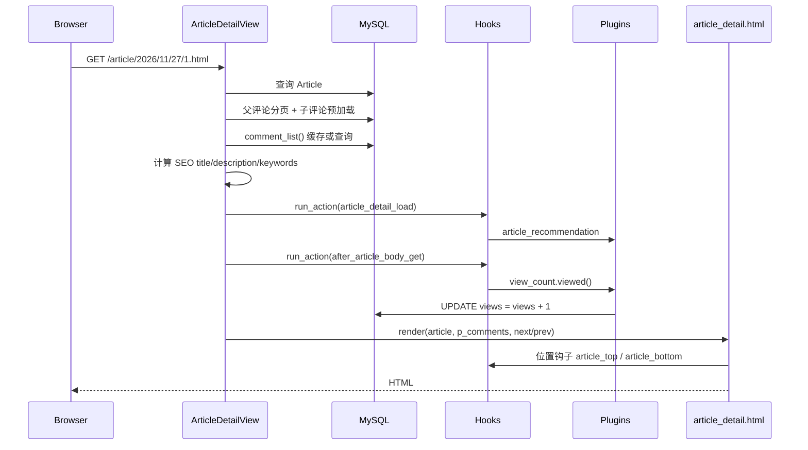

## 4. 评论提交与通知

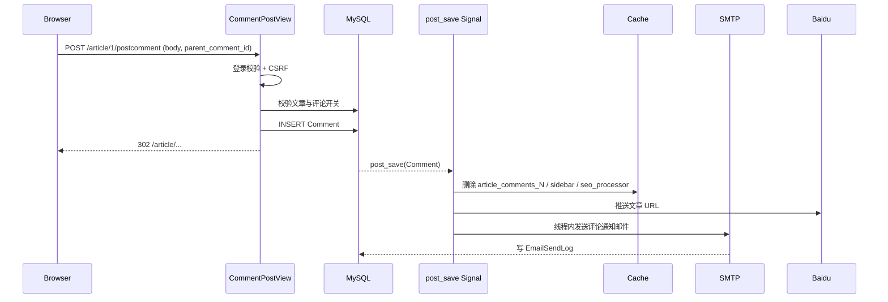

## 5. 全文检索

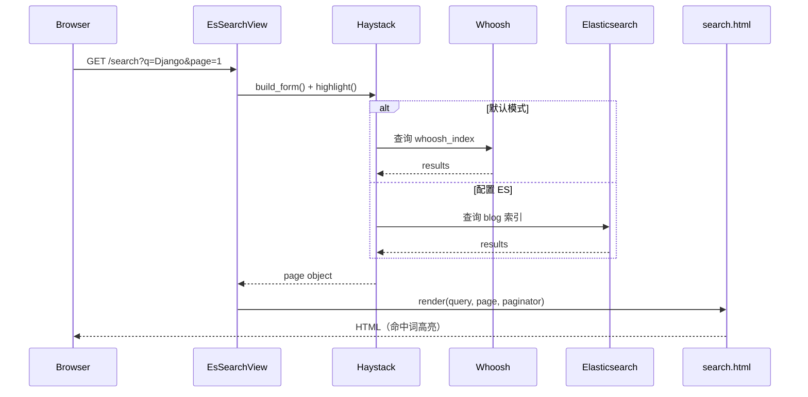

## 6. OAuth 登录

```mermaid
sequenceDiagram
    participant U as User
    participant A as Django
    participant P as OAuth Provider
    participant DB as MySQL
    participant M as SMTP

    U->>A: GET /oauth/oauthlogin?type=github
    A-->>U: 302 Provider Authorize URL
    U->>P: 授权
    P-->>A: GET /oauth/authorize?type=github&code=...
    A->>P: 用 code 换 access_token
    P-->>A: token + userinfo
    alt 返回邮箱
        A->>DB: 按 email 获取或创建 BlogUser
        A->>DB: 保存/更新 OAuthUser
        A->>A: login() + logged_user cookie
        A-->>U: 302 next_url
    else 无邮箱
        A->>DB: 保存 OAuthUser
        A-->>U: 302 /oauth/requireemail/<id>.html
        U->>A: POST email
        A->>M: 发送确认邮件
        A-->>U: 302 bindsuccess?type=email
        U->>A: GET emailconfirm/<id>/<sign>.html
        A->>DB: 绑定并激活
        A-->>U: 302 bindsuccess?type=success
    end
```

## 7. 图床上传

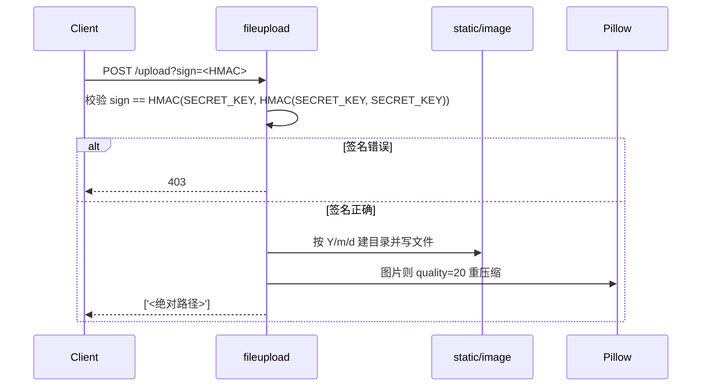

## 8. 缓存失效

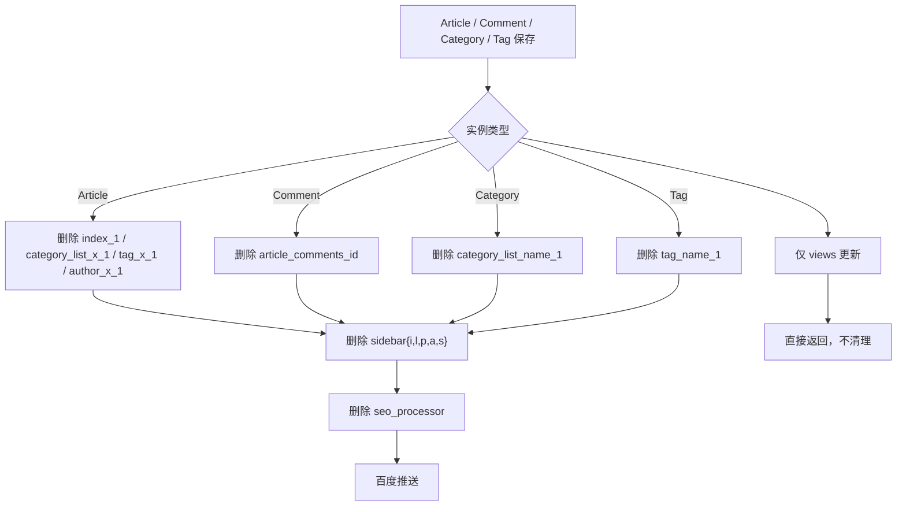

## 9. ER 图

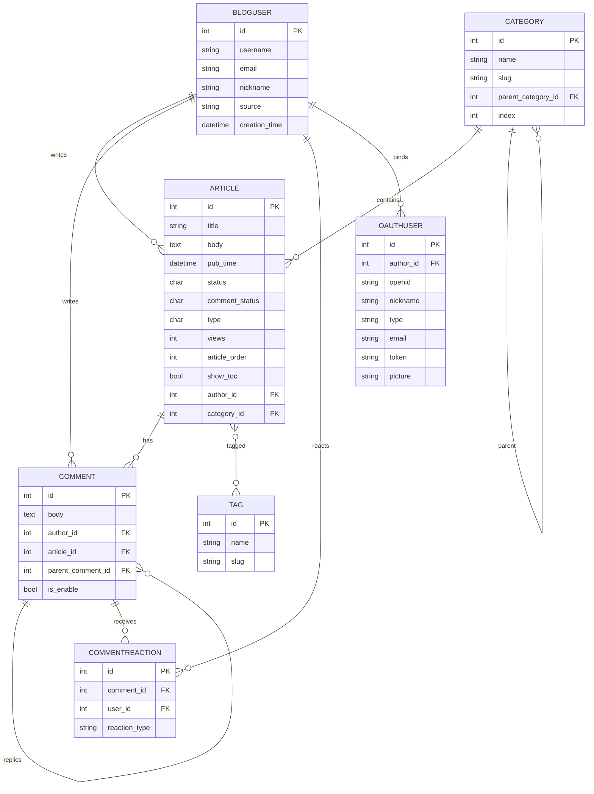

独立配置类实体：

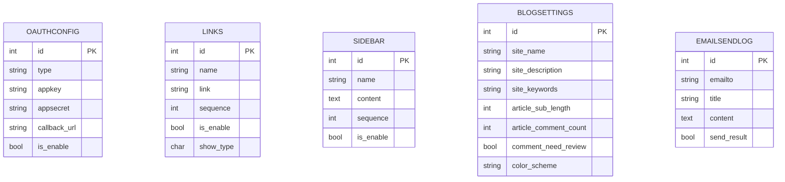

## 10. 文章状态

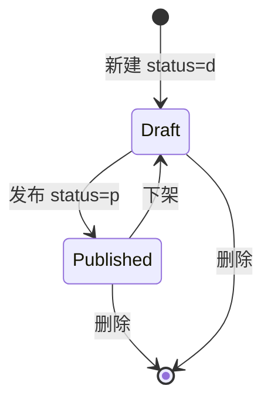

评论开关独立：

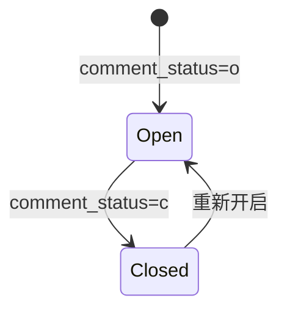

## 11. 插件调用

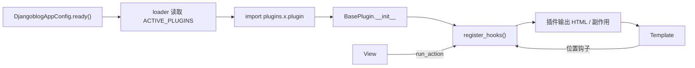

## 12. 容器启动

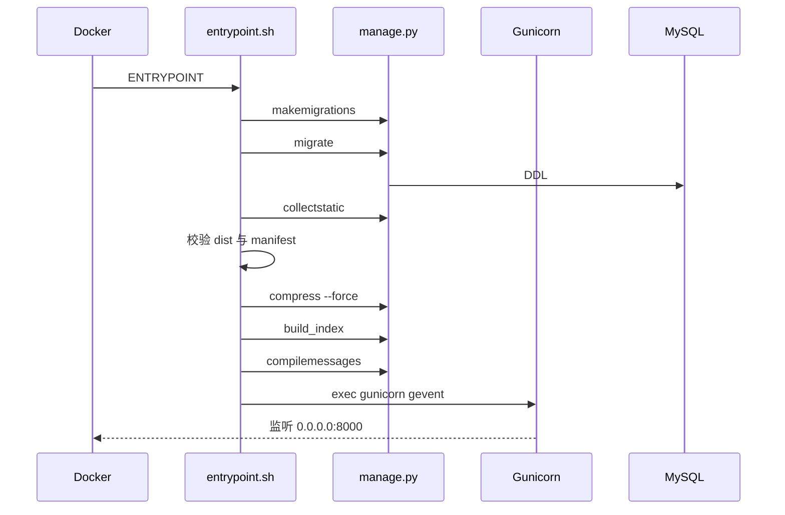
