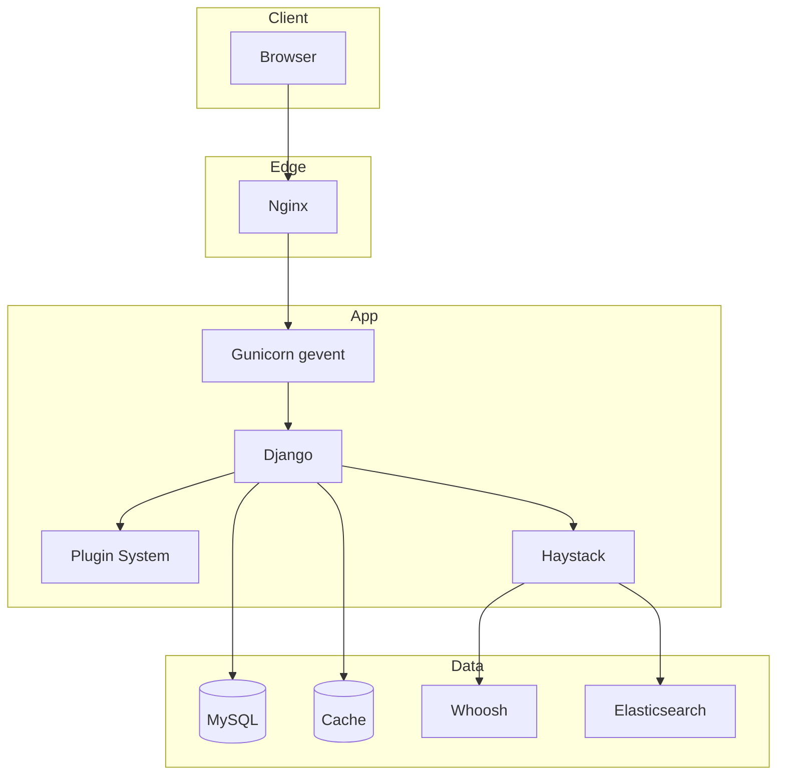
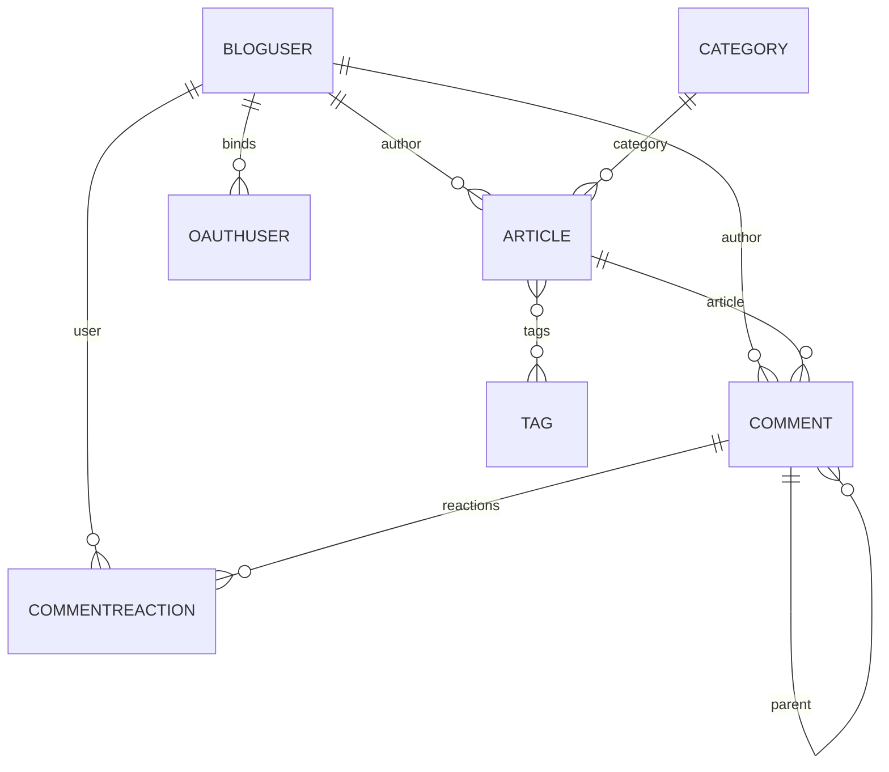

# DjangoBlog 技术文档

> 适用代码：当前 `master` 分支
> 运行环境：Python 3.10+、MySQL 5.7+/8.0、Node.js 18+（仅构建前端）
> 相关文档：[接口示例](./api-examples.md) ｜ [架构与时序图](./diagrams.md)

## 目录

1. [项目简介](#1-项目简介)
2. [技术栈](#2-技术栈)
3. [系统架构](#3-系统架构)
4. [数据模型](#4-数据模型)
5. [HTTP 接口](#5-http-接口)
6. [页面与前端](#6-页面与前端)
7. [插件系统](#7-插件系统)
8. [搜索与缓存](#8-搜索与缓存)
9. [安全设计](#9-安全设计)
10. [部署与配置](#10-部署与配置)
11. [测试](#11-测试)
12. [已知风险](#12-已知风险)
13. [附录](#13-附录)

## 1. 项目简介

DjangoBlog 是一个服务端渲染的多用户博客系统，核心能力：

- Markdown 写作、代码高亮、文章目录
- 分类（树形）、标签、独立页面、友情链接、自定义侧边栏
- 邮箱注册与激活、找回密码、用户名/邮箱登录
- 评论、二级回复、Emoji 反应、评论审核
- 微博/Google/GitHub/Facebook/QQ 登录与邮箱绑定
- Whoosh（jieba）或 Elasticsearch（IK）全文检索
- 插件系统、三语 i18n、RSS、Sitemap、百度推送
- Docker / Kubernetes 部署

## 2. 技术栈

| 层次 | 组件 |
| --- | --- |
| Web | Django 5.2.18 |
| 数据库 | MySQL（`pymysql` 作为 MySQLdb 适配层） |
| 缓存 | LocMem（默认）/ Redis（`DJANGO_REDIS_URL`） |
| 搜索 | django-haystack 3.4.0 + Whoosh 2.7.4 + jieba；可选 Elasticsearch 8 + elasticsearch-dsl |
| 内容 | django-mdeditor、Markdown、Pygments、nh3 |
| 静态资源 | django-compressor、django-libsass、ManifestStaticFilesStorage |
| 前端 | Alpine.js 3.17、Tailwind CSS 3.4、HTMX 2.0、Vite 2.9、NProgress |
| 其他 | WeRoBot、openai、Pillow、requests、uuslug、user-agents、ipware |
| 部署 | Gunicorn(gevent) + Nginx；Docker 多阶段构建；K8s manifests |

## 3. 系统架构

### 3.1 模块划分



| 模块 | 职责 |
| --- | --- |
| `blog` | 内容模型、前台列表/详情、搜索视图、站点配置、上下文处理器、渲染耗时中间件 |
| `accounts` | 自定义用户、认证视图、邮箱或用户名登录后端 |
| `comments` | 评论、回复、Emoji 反应、评论邮件 |
| `oauth` | 第三方登录管理器、邮箱补录与绑定 |
| `servermanager` | 命令模板、邮件日志、微信机器人、AI 接口 |
| `djangoblog` | 配置、路由、工具、Mixin、基类视图、信号、插件引擎、搜索后端、RSS/Sitemap |
| `plugins` | 可插拔功能 |
| `frontend` | Vite + Alpine 组件源码 |

### 3.2 请求链路

1. Nginx → Gunicorn → `SecurityMiddleware` … `ConditionalGetMiddleware` → `OnlineMiddleware`
2. `LocaleMiddleware` 根据 URL 前缀（`/en/`、`/zh-hant/`）或 cookie 选择语言
3. 视图读取缓存 → 查询 MySQL → 渲染模板
4. 模板调用 `load_sidebar`、`vite_tags`、插件位置钩子
5. `OnlineMiddleware` 替换渲染耗时占位符，可选写入 ES 性能索引

### 3.3 后台任务与通知

- 邮件：`send_email()` → 自定义信号 → SMTP → `EmailSendLog`
- 评论通知：`_thread.start_new_thread` 异步发送（无重试）
- 百度推送：`post_save` 时调用
- Cloudflare：插件在文章变更时清理缓存

## 4. 数据模型



| 模型 | 关键字段 | 说明 |
| --- | --- | --- |
| `BlogUser` | `username`、`email`、`nickname`、`source` | 继承 `AbstractUser` |
| `Article` | `title`、`body`、`pub_time`、`status(d/p)`、`comment_status(o/c)`、`type(a/p)`、`views`、`article_order`、`show_toc`、`author`、`category`、`tags` | 排序 `-article_order,-pub_time`；4 个组合索引 |
| `Category` | `name`、`parent_category`、`slug`、`index` | 树形，`get_sub_categorys()` 递归 |
| `Tag` | `name`、`slug` | `get_article_count()` |
| `Comment` | `body`、`author`、`article`、`parent_comment`、`is_enable` | 默认待审核；2 个组合索引 |
| `CommentReaction` | `comment`、`user`、`reaction_type` | 8 种 Emoji；三元唯一 |
| `Links` | `name`、`link`、`sequence`、`is_enable`、`show_type` | 首页/列表/文章/全部/幻灯片 |
| `SideBar` | `name`、`content`、`sequence`、`is_enable` | 自定义 HTML 区块 |
| `BlogSettings` | 站点信息、SEO、分页、主题色、备案、统计、审核开关 | 单例，保存时清缓存 |
| `OAuthUser` | `openid`、`nickname`、`token`、`picture`、`type`、`email`、`metadata`、`author` | 第三方账号 |
| `OAuthConfig` | `type`、`appkey`、`appsecret`、`callback_url`、`is_enable` | 每平台一条 |
| `EmailSendLog` | `emailto`、`title`、`content`、`send_result` | 邮件审计 |

约定与注意：

- `Article.get_absolute_url()` 使用 `creation_time` 的年月日
- `BaseModel.save()` 在存在 `slug` 字段时每次重新生成 slug
- `Comment.is_enable` 默认 False；`BlogSettings.comment_need_review=False` 时提交即通过

## 5. HTTP 接口

所有业务路由由 `i18n_patterns(prefix_default_language=False)` 包裹：默认语言无前缀，其他语言带 `/en/`、`/zh-hant/` 前缀。

### 5.1 路由总表

| 方法 | 路径 | 名称 | 权限 | 说明 |
| --- | --- | --- | --- | --- |
| GET | `/health/` | `health_check` | 公开 | 健康检查 JSON |
| POST | `/i18n/setlang/` | 内置 | 公开 | 切换语言 |
| GET | `/` | `blog:index` | 公开 | 首页 |
| GET | `/page/<n>/` | `blog:index_page` | 公开 | 首页分页 |
| GET | `/article/<y>/<m>/<d>/<id>.html` | `blog:detailbyid` | 公开 | 文章详情 |
| GET | `/category/<slug>.html` | `blog:category_detail` | 公开 | 分类列表 |
| GET | `/category/<slug>/<n>.html` | `blog:category_detail_page` | 公开 | 分类分页 |
| GET | `/author/<name>.html` | `blog:author_detail` | 公开 | 作者列表 |
| GET | `/author/<name>/<n>.html` | `blog:author_detail_page` | 公开 | 作者分页 |
| GET | `/tag/<slug>.html` | `blog:tag_detail` | 公开 | 标签列表 |
| GET | `/tag/<slug>/<n>.html` | `blog:tag_detail_page` | 公开 | 标签分页 |
| GET | `/archives.html` | `blog:archives` | 公开 | 归档（HTTP 缓存 1 小时） |
| GET | `/links.html` | `blog:links` | 公开 | 友链 |
| POST | `/upload?sign=...` | `blog:upload` | 签名 | 图床上传 |
| GET | `/clean` | `blog:clean` | 公开 | 清空缓存（风险） |
| GET/POST | `/login/` | `account:login` | 公开 | 登录 |
| GET/POST | `/register/` | `account:register` | 公开 | 注册 |
| GET | `/logout/` | `account:logout` | 公开 | 登出 |
| GET | `/account/result.html` | `account:result` | 公开/签名 | 注册与激活结果 |
| GET/POST | `/forget_password/` | `account:forget_password` | 公开 | 重置密码 |
| POST | `/forget_password_code/` | `account:forget_password_code` | 公开 | 发送验证码 |
| GET/POST | `/article/<id>/postcomment` | `comment:postcomment` | 登录 + CSRF | 提交评论 |
| GET | `/comment/<id>/react` | `comment:comment_react` | 公开 | 反应统计 |
| POST | `/comment/<id>/react` | 同上 | 登录 + CSRF | 切换反应 |
| GET | `/oauth/oauthlogin` | `oauth:oauthlogin` | 公开 | 发起第三方登录 |
| GET | `/oauth/authorize` | 无 | 公开 | 授权回调 |
| GET/POST | `/oauth/requireemail/<id>.html` | `oauth:require_email` | 公开 | 补录邮箱 |
| GET | `/oauth/emailconfirm/<id>/<sign>.html` | `oauth:email_confirm` | 签名 | 邮箱确认 |
| GET | `/oauth/bindsuccess/<id>.html` | `oauth:bindsuccess` | 公开 | 绑定结果 |
| GET | `/search?q=&page=` | `search` | 公开 | 全文检索 |
| GET | `/feed/`、`/rss/` | 无 | 公开 | RSS |
| GET | `/sitemap.xml` | `django.contrib.sitemaps.views.sitemap` | 公开 | 站点地图 |
| GET/POST | `/robot` | 无 | 微信签名 | 公众号机器人 |
| GET/POST | `/admin/...` | 自定义 | superuser | 后台 |
| GET/POST | `/mdeditor/...` | 第三方 | 登录 | 编辑器上传 |

### 5.2 认证与签名

- 表单接口均需 CSRF：`csrfmiddlewaretoken` 或 `X-CSRFToken`
- 评论、反应 POST 需登录
- 注册激活：`HMAC_SHA256(SECRET_KEY, HMAC_SHA256(SECRET_KEY, SECRET_KEY + user_id))`
- OAuth 绑定：`HMAC_SHA256(SECRET_KEY, SECRET_KEY + oauth_id + SECRET_KEY)`
- 图床：`HMAC_SHA256(SECRET_KEY, HMAC_SHA256(SECRET_KEY, SECRET_KEY))`

完整请求样例见 [api-examples.md](./api-examples.md)。

### 5.3 错误约定

| 状态码 | 场景 |
| --- | --- |
| 302 | 登录成功、评论成功、OAuth 跳转、语言切换 |
| 400 | Emoji 类型非法 |
| 401 | 未登录对评论点反应 |
| 403 | CSRF 失败、签名错误 |
| 404 | 文章/评论/分类不存在 |
| 500 | 评论已关闭触发 `ValidationError`；图床非图片文件压缩失败 |

## 6. 页面与前端

| 页面 | 路由 | 模板 | 功能 |
| --- | --- | --- | --- |
| 首页/列表 | `/` | `blog/article_index.html` | 卡片流、分页、侧边栏、首页友链 |
| 详情 | `/article/...` | `blog/article_detail.html` | 正文、TOC、插件位、评论、上下篇 |
| 归档 | `/archives.html` | `blog/article_archives.html` | 年月分组时间线 |
| 友链 | `/links.html` | `blog/links_list.html` | 友链卡片 |
| 搜索 | `/search` | `search/search.html` | 关键词、高亮、分页 |
| 登录/注册/找回 | `/login/` 等 | `account/*.html` | 表单、密码显隐、OAuth 入口 |
| OAuth | `/oauth/...` | `oauth/*.html` | 补录邮箱、绑定结果 |
| 错误 | — | `djangoblog/error_views.py` | 404/500/403 |

公共布局 `templates/share_layout/base.html`：

- SEO meta、Open Graph、JSON-LD
- 防闪烁暗色主题（`localStorage['dark-mode-enabled']`、`window.themeManager`）
- Vite manifest 注入资源；插件 `head_resources` / `body_resources`
- HTMX `hx-boost` 替换 `#main`；NProgress
- 导航、页脚、备案、统计代码、公共头尾 HTML
- MathJax、图片灯箱、代码复制、回到顶部

前端组件（`frontend/src/components/`）：`backToTop`、`codeCopy`、`commentSystem`、`legacyComments`、`imageLightbox`、`navigation`、`reactionPicker`。

## 7. 插件系统

### 7.1 生命周期

1. `DjangoblogAppConfig.ready()` 调用 loader
2. 按 `settings.ACTIVE_PLUGINS` 导入 `plugins.<name>.plugin`
3. 实例化 `BasePlugin` 子类，执行 `init_plugin()`、`register_hooks()`
4. 视图通过 `hooks.run_action()` / `hooks.apply_filters()` 触发
5. 模板通过位置钩子渲染组件

### 7.2 扩展点

| 类型 | API | 用途 |
| --- | --- | --- |
| Action | `hooks.register(name, fn)` / `hooks.run_action(name, **kw)` | 副作用、上下文增强 |
| Filter | `hooks.apply_filters(name, value, **kw)` | 修改正文/元信息 |
| 位置 | `SUPPORTED_POSITIONS` + `render_<pos>_widget()` | 页面区块 |
| 资源 | `get_critical_head_html` / `get_head_html` / `get_body_html` / `get_css_files` / `get_js_files` | 注入 CSS/JS |
| 模板 | `render_template('x.html', ctx)` | 渲染 `templates/plugins/<slug>/` |

### 7.3 内置插件

| 插件 | 挂载 | 功能 |
| --- | --- | --- |
| `view_count` | `after_article_body_get` | 浏览量 +1 |
| `article_copyright` | `the_content` | 文末版权 |
| `reading_time` | `the_content` | 阅读时长 |
| `external_links` | `the_content` | 外链 `target/rel` |
| `image_lazy_loading` | `the_content` | 图片懒加载 |
| `seo_optimizer` | `head_meta` | SEO 补全 |
| `article_recommendation` | `article_detail_load`、`article_bottom` | 相关推荐 |
| `cloudflare_cache` | 保存信号 | 清理 CDN 缓存 |

新增插件步骤：

```bash
mkdir -p plugins/my_plugin
```

```python
# plugins/my_plugin/plugin.py
from djangoblog.plugin_manage.base_plugin import BasePlugin
from djangoblog.plugin_manage import hooks

class MyPlugin(BasePlugin):
    PLUGIN_NAME = '示例插件'
    PLUGIN_DESCRIPTION = '示例'
    PLUGIN_VERSION = '0.1.0'
    PLUGIN_AUTHOR = 'you'

    def register_hooks(self):
        hooks.register('the_content', self.add_notice)

    def add_notice(self, content, **kwargs):
        return content + '<p>示例插件</p>'

plugin = MyPlugin()
```

把 `my_plugin` 加入 `settings.ACTIVE_PLUGINS` 即可。

## 8. 搜索与缓存

### 8.1 搜索

| 项 | 说明 |
| --- | --- |
| 默认后端 | `djangoblog.whoosh_cn_backend.WhooshEngine`，索引目录 `whoosh_index/`，jieba 分词 |
| 可选后端 | 设置 `DJANGO_ELASTICSEARCH_HOST` 后使用 `ElasticSearchEngine`，索引名 `blog`，IK 分词 |
| 索引类 | `ArticleIndex`（`text/title/body`，仅 `status='p'`）；ES 另用 `ArticleDocument` |
| 实时更新 | `HAYSTACK_SIGNAL_PROCESSOR = RealtimeSignalProcessor` |
| 查询视图 | `EsSearchView`，启用 `.highlight()`，模板 `search/search.html` |
| 建索引 | Whoosh：`rebuild_index`；ES：`build_index` |
| 性能日志 | ES 模式下 `OnlineMiddleware` 写 `performance` 索引 |

### 8.2 缓存

| 键 | TTL | 失效 |
| --- | --- | --- |
| `index_{page}` | 默认 3 小时 | 只清第 1 页 |
| `category_list_{name}_{page}` | 默认 | 只清第 1 页 |
| `tag_{name}_{page}` | 默认 | 只清第 1 页 |
| `author_{slug}_{page}` | 默认 | 只清第 1 页 |
| `archives` | 默认 + 整页 1 小时 | 文章保存 |
| `article_comments_{id}` | 10 小时 | 评论保存 |
| `get_blog_setting` | 默认 | 配置保存全清 |
| `seo_processor` | 10 小时 | 文章/分类/评论保存 |
| `sidebar{i,l,p,a,s}` | 648000 秒 | 内容变更、登录登出 |
| `breadcrumb_v3` | 36000 秒 | 到期 |
| `avatar/{email}` | 24 小时 | 到期 |

生产建议使用 Redis；LocMem 在多 worker 下各自独立，命中率低且失效不一致。

## 9. 安全设计

| 项 | 实现 |
| --- | --- |
| CSRF | 全局中间件 + 表单基类显式 `csrf_protect` |
| 登录 | `login_required`、`LOGIN_URL='/login/'` |
| 密码保护 | `sensitive_post_parameters('password')` |
| 缓存控制 | 登录/登出 `never_cache` |
| 开放重定向 | `url_has_allowed_host_and_scheme` |
| XSS | `nh3` 白名单（标签、属性、`http/https/mailto`） |
| 上传 | `normpath + startswith` 防穿越 |
| 签名 | HMAC-SHA256（激活、绑定、图床） |
| 后台 | 自定义 AdminSite，仅 superuser |
| 点击劫持 | `X_FRAME_OPTIONS='SAMEORIGIN'` |

生产部署前必须处理：

1. 用环境变量覆盖 `SECRET_KEY`
2. 收紧 `ALLOWED_HOSTS` 与 `CSRF_TRUSTED_ORIGINS`
3. 为 `/clean` 增加鉴权
4. 把 `DEBUG` 设为 `False`

## 10. 部署与配置

### 10.1 本地开发

```bash
python -m venv .venv
source .venv/bin/activate
pip install -r requirements.txt pymysql
python manage.py migrate
python manage.py runserver
# 另开终端
cd frontend && npm ci && npm run dev
```

### 10.2 Docker

- 阶段一 `node:20-alpine` 构建前端到 `blog/static/blog/dist`
- 阶段二 `python:3.11` 安装依赖与 `gunicorn[gevent]`
- 入口 `deploy/entrypoint.sh`：

```
makemigrations → migrate → collectstatic → 校验 Vite manifest
→ 复制 .vite → compress --force → build_index → compilemessages
→ gunicorn gevent :8000
```

### 10.3 Kubernetes

`deploy/k8s/` 提供 Deployment、Service、Gateway、ConfigMap、PV/PVC、StorageClass；健康探针使用 `/health/`。

### 10.4 环境变量

| 变量 | 默认 | 说明 |
| --- | --- | --- |
| `DJANGO_SECRET_KEY` | 内置 | 生产必须覆盖 |
| `DJANGO_DEBUG` | `True` | 生产设 `False` |
| `DJANGO_REDIS_URL` | 空 | `host:port`，代码自动加 `redis://` |
| `DJANGO_ELASTICSEARCH_HOST` | 空 | 设置后启用 ES |
| `ELASTICSEARCH_USERNAME/PASSWORD/API_KEY/CA_CERTS/...` | 空 | ES 认证 |
| `DJANGO_EMAIL_HOST/PORT/USER/PASSWORD` | 阿里企业邮 | SMTP |
| `DJANGO_EMAIL_TLS/SSL` | `False/True` | 加密方式 |
| `DJANGO_BAIDU_NOTIFY_URL` | 作者站点 | 百度推送 |
| `DJANGO_WXADMIN_PASSWORD` | 内置 | 微信后台 |
| `COMPRESS_OFFLINE` | `False` | 离线压缩 |
| `OPENAI_API_KEY` | 空 | AI 接口 |
| `DJANGO_MYSQL_*` | — | **当前代码未读取** |

### 10.5 常用命令

```bash
python manage.py migrate
python manage.py collectstatic --noinput
python manage.py compress --force
python manage.py rebuild_index          # Whoosh
python manage.py build_index            # ES
python manage.py clear_cache
python manage.py createsuperuser
```

## 11. 测试

```bash
python manage.py test
coverage run manage.py test && coverage report
```

测试覆盖：文章业务逻辑、视图、后台、上下文处理器、中间件、模板标签、用户业务逻辑、评论业务逻辑、OAuth、插件、邮件集成。CI 工作流位于 `.github/workflows/`。

## 12. 已知风险

| 级别 | 风险 | 处理建议 |
| --- | --- | --- |
| 高 | `DATABASES` 硬编码，容器环境变量无效 | 改为读取 `DJANGO_MYSQL_*` |
| 高 | `pymysql` 未声明依赖 | 写入 requirements |
| 高 | `/clean` 无鉴权 | 加 superuser/签名 |
| 高 | `/upload` 签名弱、无类型大小限制、目录不可发布 | 改用媒体目录或对象存储 |
| 高 | `openai.ChatCompletion` 与 2.x 不兼容 | 迁移新版 SDK |
| 中 | 评论关闭抛 `ValidationError` → 500 | 返回 403/表单错误 |
| 中 | 分页缓存只清第 1 页 | 前缀批量失效或缩短 TTL |
| 中 | Whoosh 模式 `build_index` 不生效 | 改用 `rebuild_index` |
| 中 | `handle403` 拼写错误 | 改为 `handler403` |
| 低 | `STATICFILES_STORAGE` 弃用 | 迁移 `STORAGES` |
| 低 | Vite postcss 路径指向 `.js` | 改为 `.cjs` |

完整 29 条见 `analysis.md` 第 14 章。

## 13. 附录

### 13.1 关键目录

```
blog/                 内容与前台
accounts/             用户与认证
comments/             评论与反应
oauth/                第三方登录
servermanager/        命令、邮件日志、机器人、AI
djangoblog/           配置、工具、插件引擎、搜索后端
plugins/              插件
frontend/             Vite 前端
templates/            模板
deploy/               Docker/K8s/Nginx
locale/               i18n
```

### 13.2 相关文件

- 配置：`djangoblog/settings.py`
- 根路由：`djangoblog/urls.py`
- 插件引擎：`djangoblog/plugin_manage/`
- 前端入口：`frontend/src/main.js`
- 部署入口：`deploy/entrypoint.sh`
