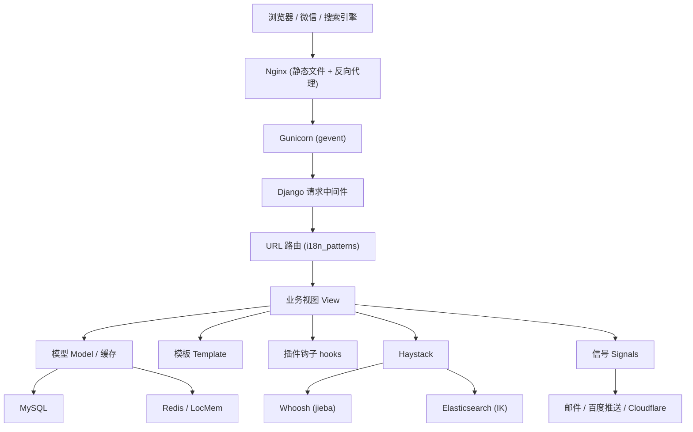
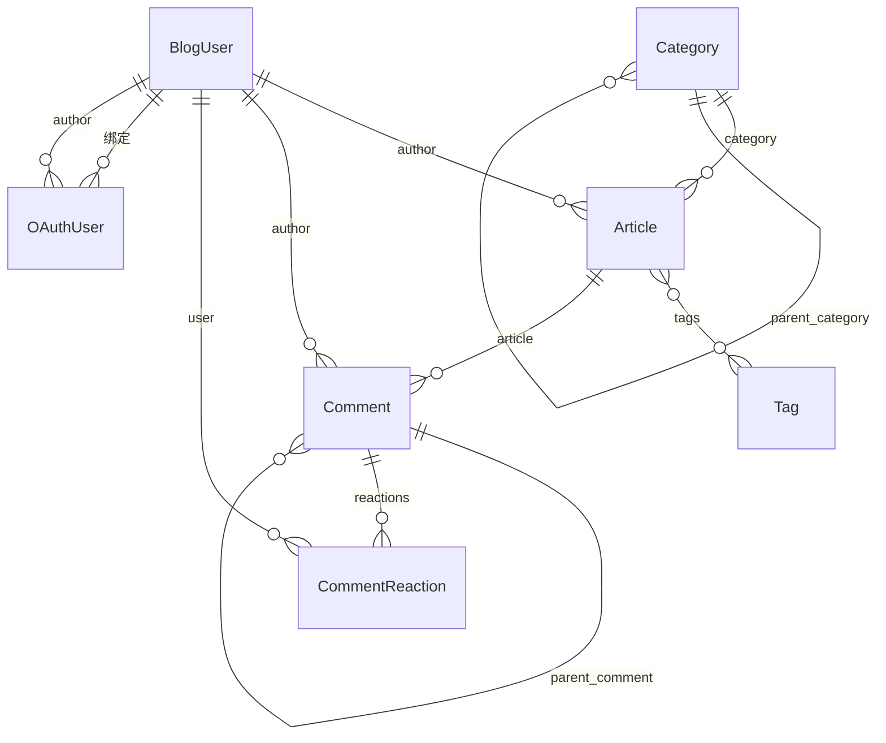

我会先系统性地收集项目信息，包括技术栈、配置、路由、模型、视图和模板结构，然后整理出继续读取各个应用的路由、模型与视图。收集最后几处细节，确认模板与静态资源结构我已通读项目的配置、路由、模型、视图、插件、模板、前端与部署文件。下面是基于当前代码整理的完整技术文档。

---

# DjangoBlog 技术文档

> 本文档基于当前仓库代码静态分析整理（分支 `master`），涵盖技术栈、架构、数据模型、全部 HTTP 接口、页面功能、插件系统、搜索、缓存、安全与部署。

## 目录

1. [项目概览](#1-项目概览)
2. [技术栈](#2-技术栈)
3. [系统架构](#3-系统架构)
4. [数据模型](#4-数据模型)
5. [HTTP 接口清单](#5-http-接口清单)
6. [页面与功能](#6-页面与功能)
7. [插件系统](#7-插件系统)
8. [搜索子系统](#8-搜索子系统)
9. [缓存与性能优化](#9-缓存与性能优化)
10. [安全设计](#10-安全设计)
11. [通知与异步任务](#11-通知与异步任务)
12. [部署与运维](#12-部署与运维)
13. [测试与 CI](#13-测试与-ci)
14. [已知问题与技术债](#14-已知问题与技术债)
15. [附录：关键文件索引](#15-附录关键文件索引)

---

## 1. 项目概览

DjangoBlog 是一个基于 **Python 3.10+ / Django 5.2** 的全功能博客平台，采用服务端渲染 + 轻量前端增强（Alpine.js +
HTMX）的架构，内置 Markdown 编辑、全文搜索、OAuth 登录、评论与 emoji 反应、插件系统、SEO、RSS、站点地图、微信公众号机器人等能力。

| 项目项       | 说明                                                                          |
|--------------|-------------------------------------------------------------------------------|
| 项目配置模块 | `djangoblog/`（settings、urls、wsgi、feeds、sitemap、signals、plugin_manage） |
| 业务应用     | `blog`、`accounts`、`comments`、`oauth`、`servermanager`                      |
| 前端工程     | `frontend/`（Vite 构建，产物输出到 `blog/static/blog/dist`）                  |
| 数据库       | MySQL（`utf8mb4`）                                                            |
| 缓存         | LocMem（默认）/ Redis（`DJANGO_REDIS_URL`）                                   |
| 搜索         | Whoosh（默认，jieba 分词）/ Elasticsearch（IK 分词）                          |
| 部署         | Docker Compose、Kubernetes、Gunicorn(gevent) + Nginx                          |
| 许可证       | MIT                                                                           |

### 目录结构（核心）

```
DjangoBlog/
├── djangoblog/          # 项目配置与公共基础设施
│   ├── settings.py      # 全局配置
│   ├── urls.py          # 根路由（i18n_patterns）
│   ├── utils.py         # 缓存装饰器、Markdown、HTML 清洗、邮件等
│   ├── mixins.py        # 视图/模型复用 Mixin
│   ├── base_views.py    # 安全视图基类
│   ├── blog_signals.py  # 全局信号（缓存清理、邮件、百度推送）
│   ├── plugin_manage/   # 插件加载器、钩子系统、基类
│   ├── elasticsearch_backend.py / whoosh_cn_backend.py
│   ├── feeds.py / sitemap.py / error_views.py / admin_site.py
├── blog/                # 文章、分类、标签、友链、侧边栏、站点配置
├── accounts/            # 自定义用户与登录/注册/找回密码
├── comments/            # 评论与 emoji 反应
├── oauth/               # 第三方登录（微博/Google/GitHub/Facebook/QQ）
├── servermanager/       # 微信公众号机器人、服务器命令、邮件日志
├── plugins/             # 8 个内置插件
├── templates/           # Django 模板
├── frontend/            # Alpine.js/Tailwind/HTMX/Vite 源码
├── deploy/              # docker-compose / k8s / nginx / entrypoint
├── locale/              # en / zh_Hans / zh_Hant 国际化
└── docs/                # 配置、部署、ES 文档
```

---

## 2. 技术栈

### 2.1 后端依赖（`requirements.txt`）

| 分类      | 组件                                     | 版本            | 用途                                    |
|-----------|------------------------------------------|-----------------|-----------------------------------------|
| 框架      | Django                                   | 5.2.18          | Web 框架                                |
| 搜索      | django-haystack                          | 3.4.0           | 搜索抽象层                              |
| 搜索      | Whoosh                                   | 2.7.4           | 默认全文索引                            |
| 搜索      | elasticsearch / elasticsearch-dsl        | 8.19.3 / 8.11.0 | ES 客户端与文档映射                     |
| 搜索      | jieba                                    | 0.42.1          | 中文分词（Whoosh）                      |
| 编辑器    | django-mdeditor                          | 0.1.20          | Markdown 编辑器与上传                   |
| Markdown  | Markdown                                 | 3.11.2          | 正文渲染（extra/codehilite/toc/tables） |
| 代码高亮  | Pygments                                 | 2.21.0          | codehilite 样式                         |
| HTML 清洗 | nh3                                      | 0.3.7           | XSS 白名单过滤                          |
| 静态资源  | django-compressor                        | 4.6.0           | CSS/JS 合并压缩                         |
| 缓存      | redis                                    | 7.4.1           | Redis 缓存后端                          |
| 缓存/图片 | pillow                                   | 13.0.0          | 图床上传压缩                            |
| 邮件      | Django SMTP                              | -               | 验证邮件、评论通知                      |
| 微信      | WeRoBot                                  | 1.13.1          | 公众号机器人                            |
| AI        | openai                                   | 2.54.0          | 机器人闲聊（见技术债）                  |
| 其他      | django-ipware、user-agents               | -               | 访问日志（ES performance 索引）         |
| 其他      | uuslug、python-slugify                   | -               | slug 生成                               |
| 其他      | requests、beautifulsoup4、jsonpickle     | -               | 头像下载、搜索高亮、会话序列化          |
| 其他      | django-echarts / pyecharts / prettytable | -               | 依赖已引入，核心流程未直接使用          |

### 2.2 前端技术

| 组件             | 版本                         | 用途                                       |
|------------------|------------------------------|--------------------------------------------|
| Alpine.js        | 3.17.5                       | 声明式交互（导航、评论、灯箱、回到顶部）   |
| Alpine 插件      | focus / intersect / collapse | 焦点捕获、可视区检测、折叠                 |
| Tailwind CSS     | 3.4.1（typography 插件）     | 原子化样式，`frontend/src/styles/main.css` |
| HTMX             | 2.0.11                       | `hx-boost` 无刷新导航（替换 `#main`）      |
| Vite             | 2.9                          | 构建、HMR、manifest                        |
| Terser / cssnano | -                            | 极限压缩                                   |
| NProgress        | 自实现                       | 页面加载进度条                             |

### 2.3 运行环境特性

- 国际化：`LANGUAGES = en / zh-hans / zh-hant`，默认 `zh-hans`，`USE_TZ=False`，时区 `Asia/Shanghai`。
- 静态资源：`STATIC_ROOT=collectedstatic`，`STATICFILES_DIRS=[plugins]`；生产使用 `ManifestStaticFilesStorage`（Django 5.2
  中已弃用，见技术债）。
- 媒体文件：`MEDIA_ROOT=uploads`，`MEDIA_URL=/media/`。
- 日志：`logs/djangoblog.log`，按天轮转保留 5 份；DEBUG 时输出控制台。

---

## 3. 系统架构

### 3.1 分层结构



### 3.2 Django App 职责

| App             | 职责                                                                               | 关键模型                                             |
|-----------------|------------------------------------------------------------------------------------|------------------------------------------------------|
| `blog`          | 文章/分类/标签/友链/侧边栏/站点配置、首页与列表、归档、搜索视图、图床、Sitemap/RSS | Article、Category、Tag、Links、SideBar、BlogSettings |
| `accounts`      | 自定义用户、登录/注册/登出/找回密码、邮箱激活                                      | BlogUser                                             |
| `comments`      | 评论提交、嵌套回复、emoji 反应 API                                                 | Comment、CommentReaction                             |
| `oauth`         | 第三方登录、OAuth 账号绑定、邮箱补全                                               | OAuthUser、OAuthConfig                               |
| `servermanager` | 微信公众号机器人、服务器命令、邮件发送日志                                         | commands、EmailSendLog                               |
| `djangoblog`    | 配置、公共工具、插件管理、搜索后端、管理站点、错误页                               | -                                                    |

### 3.3 请求生命周期

中间件顺序（`settings.MIDDLEWARE`）：

1. `SecurityMiddleware`
2. `SessionMiddleware`
3. `LocaleMiddleware`（i18n）
4. `GZipMiddleware`
5. `CommonMiddleware`
6. `CsrfViewMiddleware`
7. `AuthenticationMiddleware`
8. `MessageMiddleware`
9. `XFrameOptionsMiddleware`
10. `ConditionalGetMiddleware`
11. `blog.middleware.OnlineMiddleware`：统计渲染耗时、注入 `<!!LOAD_TIMES!!>` 替换；启用 ES 时写入 `performance` 索引（含
    GeoIP pipeline、UA 解析）

上下文处理器：

- Django 内置 4 个
- `blog.context_processors.seo_processor`：站点名称/描述/关键词、导航分类、独立页面、备案号、统计代码、颜色主题、GLOBAL_HEADER/FOOTER、评论审核开关（缓存
  10 小时，动态更新 URL 与年份）

信号（`djangoblog/blog_signals.py`）：

- `post_save`：清理列表/侧边栏/SEO 缓存；百度推送；评论启用时清详情缓存并异步发邮件；浏览量更新（`update_fields={'views'}`）跳过
- `oauth_user_login_signal`：下载并本地化 OAuth 头像
- `send_email_signal`：发送 HTML 邮件并记录 `EmailSendLog`
- `user_logged_in/out`：清侧边栏缓存

---

## 4. 数据模型

### 4.1 模型关系



### 4.2 `blog` 应用

#### Article（文章/独立页面）

| 字段                             | 类型                   | 说明                                |
|----------------------------------|------------------------|-------------------------------------|
| id                               | AutoField              | 主键                                |
| title                            | CharField(200, unique) | 标题                                |
| body                             | MDTextField            | Markdown 正文（mdeditor）           |
| pub_time                         | DateTimeField          | 发布时间                            |
| status                           | CharField(1)           | `d` 草稿 / `p` 已发布               |
| comment_status                   | CharField(1)           | `o` 开放 / `c` 关闭                 |
| type                             | CharField(1)           | `a` 文章 / `p` 独立页面（用于导航） |
| views                            | PositiveIntegerField   | 浏览量                              |
| author                           | FK(BlogUser)           | 作者                                |
| article_order                    | IntegerField           | 排序权重（越大越靠前）              |
| show_toc                         | BooleanField           | 是否显示目录                        |
| category                         | FK(Category)           | 分类                                |
| tags                             | M2M(Tag)               | 标签                                |
| creation_time / last_modify_time | DateTimeField          | 时间戳                              |

- 排序：`-article_order, -pub_time`
- 索引：`(type,status,-pub_time)`、`(status,-views)`、`(author,status,type)`、`(category,status)`
- 方法：`get_absolute_url()`、`viewed()`（浏览量 +1，`update_fields=['views']` 时直写 SQL 避免信号）、`next_article()` /
  `prev_article()`（缓存 10 小时）、`comment_list()`（缓存 10 小时）、`get_first_image_url()`（正则提取首图）、
  `get_category_tree()`

#### Category（分类，支持父子层级）

| 字段            | 说明                                                |
|-----------------|-----------------------------------------------------|
| name            | 唯一名称                                            |
| parent_category | 自关联父分类                                        |
| slug            | SlugField，保存时由 `uuslug.slugify(name)` 自动生成 |
| index           | 排序权重                                            |

方法：`get_category_tree()`（自身到根）、`get_sub_categorys()`（递归所有子分类，均缓存 10 小时）。

#### Tag（标签）

`name`（唯一）、`slug`；`get_article_count()` 统计关联文章数（缓存）。

#### Links（友情链接）

`name`、`link`、`sequence`（唯一排序）、`is_enable`、`show_type`（`i` 首页 / `l` 列表 / `p` 文章页 / `a` 全部 / `s` 幻灯片）。

#### SideBar（自定义侧边栏 HTML 模块）

`name`、`content`（Markdown）、`sequence`（唯一）、`is_enable`。

#### BlogSettings（站点配置，单例）

`site_name`、`site_description`、`site_seo_description`、`site_keywords`、`article_sub_length`（摘要长度，默认 300）、
`sidebar_article_count`、`sidebar_comment_count`、`article_comment_count`（详情页评论分页，默认 5）、`show_google_adsense`、
`google_adsense_codes`、`open_site_comment`、`color_scheme`（8 种配色）、`global_header`、`global_footer`、`beian_code`、
`analytics_code`、`show_gongan_code`、`gongan_beiancode`、`comment_need_review`。

- `clean()` 强制只能存在一条记录
- `save()` 后执行 `cache.clear()`

### 4.3 `accounts` 应用

#### BlogUser（`AUTH_USER_MODEL`）

继承 `AbstractUser`，新增 `nickname`、`creation_time`、`last_modify_time`、`source`（Register / authorize / emailconfirm /
adminsite）。排序 `-id`；`get_absolute_url()` 指向作者页。

### 4.4 `comments` 应用

#### Comment

| 字段                             | 说明                            |
|----------------------------------|---------------------------------|
| body                             | TextField（表单层限制 300 字）  |
| author                           | FK(BlogUser)                    |
| article                          | FK(Article)                     |
| parent_comment                   | 自关联（嵌套回复）              |
| is_enable                        | 是否审核通过/显示（默认 False） |
| creation_time / last_modify_time | 时间戳                          |

索引：`(article,parent_comment,is_enable)`、`(is_enable,-id)`；`get_reactions_summary(user)` 返回 emoji 统计与当前用户是否已点。

#### CommentReaction

`comment`、`user`、`reaction_type`（👍👎❤️😄🎉😕🚀👀）、`created_at`；唯一约束 `(comment,user,reaction_type)`；索引
`(comment,reaction_type)`。

### 4.5 `oauth` 应用

#### OAuthUser

`author`（可空，绑定本地用户）、`openid`、`nickname`、`token`、`picture`、`type`（weibo/google/github/facebook/qq）、`email`、
`metadata`（原始 JSON）、时间戳。

#### OAuthConfig

`type`、`appkey`、`appsecret`、`callback_url`、`is_enable`；同一 `type` 唯一。

### 4.6 `servermanager` 应用

#### commands

`title`、`command`、`describe`、时间戳 —— 供微信机器人管理员执行服务器命令。

#### EmailSendLog

`emailto`、`title`、`content`、`send_result`、`creation_time` —— 邮件发送审计。

---

## 5. HTTP 接口清单

> 路由位于 `djangoblog/urls.py` 的 `i18n_patterns(prefix_default_language=False)` 中：中文访问无前缀（`/article/...`），英文访问
> `/en/...`，繁体 `/zh-hant/...`。

### 5.1 全局接口（非 i18n 前缀）

| 方法     | 路径              | 名称                                    | 视图                               | 作用                                                                                           |
|----------|-------------------|-----------------------------------------|------------------------------------|------------------------------------------------------------------------------------------------|
| GET      | `/health/`        | `health_check`                          | `djangoblog.urls.health_check`     | 健康检查，返回 `{"status":"healthy","timestamp":...}`；K8s 存活/就绪探针使用                   |
| GET/POST | `/i18n/`          | -                                       | `django.conf.urls.i18n`            | 语言切换（`set_language`）                                                                     |
| GET      | `/sitemap.xml`    | `django.contrib.sitemaps.views.sitemap` | Sitemap                            | 生成文章/分类/标签/作者/静态页站点地图                                                         |
| GET      | `/feed/`、`/rss/` | -                                       | `DjangoBlogFeed`                   | RSS 2.0，最近 5 篇已发布文章，正文转 HTML                                                      |
| GET      | `/search`         | `search`                                | `blog.views.EsSearchView`          | Haystack 搜索，`?q=关键词&page=&is_suggest=no`；支持中文分词、关键词高亮（`<mark>`）、拼写建议 |
| GET/POST | `/robot`          | `servermanager:robot`                   | `werobot.contrib.django.make_view` | 微信公众号接入（校验、消息处理）                                                               |
| GET      | `/admin/`         | -                                       | 自定义 `DjangoBlogAdminSite`       | 后台管理，仅 `is_superuser` 可访问                                                             |
| -        | `/mdeditor/`      | -                                       | `mdeditor.urls`                    | Markdown 编辑器图片/文件上传等                                                                 |

### 5.2 博客接口（`blog`，namespace `blog`）

| 方法 | 路径                                                              | 名称                        | 视图                 | 参数 / 返回 / 说明                                                                                                                 |
|------|-------------------------------------------------------------------|-----------------------------|----------------------|------------------------------------------------------------------------------------------------------------------------------------|
| GET  | `/`                                                               | `blog:index`                | `IndexView`          | 首页文章列表（`type='a'`、`status='p'`），每页 10 条；支持 `?page=N`；列表缓存 `index_{page}`                                      |
| GET  | `/page/<int:page>/`                                               | `blog:index_page`           | `IndexView`          | 首页第 N 页（路径式分页）                                                                                                          |
| GET  | `/article/<int:year>/<int:month>/<int:day>/<int:article_id>.html` | `blog:detailbyid`           | `ArticleDetailView`  | 文章详情；`?comment_page=N` 评论分页；渲染 TOC、上下篇、SEO、插件位；触发浏览量统计插件                                            |
| GET  | `/category/<slug:category_name>.html`                             | `blog:category_detail`      | `CategoryDetailView` | 分类文章列表（包含所有子分类，`status='p'`）                                                                                       |
| GET  | `/category/<slug:category_name>/<int:page>.html`                  | `blog:category_detail_page` | `CategoryDetailView` | 分类第 N 页                                                                                                                        |
| GET  | `/author/<author_name>.html`                                      | `blog:author_detail`        | `AuthorDetailView`   | 作者文章列表（`type='a'`）                                                                                                         |
| GET  | `/author/<author_name>/<int:page>.html`                           | `blog:author_detail_page`   | `AuthorDetailView`   | 作者第 N 页                                                                                                                        |
| GET  | `/tag/<slug:tag_name>.html`                                       | `blog:tag_detail`           | `TagDetailView`      | 标签文章列表                                                                                                                       |
| GET  | `/tag/<slug:tag_name>/<int:page>.html`                            | `blog:tag_detail_page`      | `TagDetailView`      | 标签第 N 页                                                                                                                        |
| GET  | `/archives.html`                                                  | `blog:archives`             | `ArchivesView`       | 全部已发布文章按年/月分组的时间轴；`cache_page(3600)` 服务端缓存 1 小时                                                            |
| GET  | `/links.html`                                                     | `blog:links`                | `LinkListView`       | 友情链接列表（`is_enable=True`）                                                                                                   |
| POST | `/upload`                                                         | `blog:upload`               | `fileupload`         | 简易图床。必须携带 `?sign=<get_sha256(get_sha256(SECRET_KEY))>`，否则 403；multipart 多文件；图片压缩质量 20；保存至 `static/image |files/YYYY/MM/DD/uuid.ext`；返回文本形式的 URL 列表；`csrf_exempt` |
| GET  | `/clean`                                                          | `blog:clean`                | `clean_cache_view`   | 清空默认缓存，返回 `ok`（无权限校验）                                                                                              |

列表接口公共行为：

- 分页大小 `settings.PAGINATE_BY = 10`
- `CachedListViewMixin` 缓存 QuerySet；`OptimizedArticleQueryMixin` 使用 `select_related('author','category')` +
  `prefetch_related('tags')`
- 各页面在上下文中注入 `seo_title / seo_description / seo_keywords`

### 5.3 账号接口（`accounts`，include namespace `account`，`app_name='accounts'`）

| 方法     | 路径                     | 名称                            | 视图                      | 说明                                                                                                                                                                            |
|----------|--------------------------|---------------------------------|---------------------------|---------------------------------------------------------------------------------------------------------------------------------------------------------------------------------|
| GET/POST | `/login/`                | `accounts:login`                | `LoginView`               | 字段 `username`（用户名或邮箱）、`password`、`remember`、`next`；支持邮箱登录；成功设置 `logged_user` Cookie（httponly=False），会话 2 周，勾选“记住我”30 天；`next` 做同源校验 |
| GET/POST | `/register/`             | `accounts:register`             | `RegisterView`            | 字段 `username`、`email`、`password1/2`；创建 `is_active=False` 用户，`source='Register'`，发送含签名激活链接的邮件；跳转结果页                                                 |
| GET      | `/logout/`               | `accounts:logout`               | `LogoutView`              | 登出、清侧边栏缓存、删除 `logged_user` Cookie，302 到 `/login/`                                                                                                                 |
| GET      | `/account/result.html`   | `accounts:result`               | `account_result`          | `?type=register&id=` 显示“注册成功，请验证邮箱”；`?type=validation&id=&sign=` 校验签名并激活账号；已激活用户直接跳首页                                                          |
| GET/POST | `/forget_password/`      | `accounts:forget_password`      | `ForgetPasswordView`      | 字段 `email`、`new_password1/2`、`code`；校验缓存验证码后重置密码，跳 `/login/`                                                                                                 |
| POST     | `/forget_password_code/` | `accounts:forget_password_code` | `ForgetPasswordEmailCode` | 请求体 `email`；生成 6 位数字验证码，缓存 5 分钟并发送邮件；返回文本 `ok` 或 `错误的邮箱`                                                                                       |

签名规则：

- 注册激活：`sign = sha256_hmac(SECRET_KEY, sha256_hmac(SECRET_KEY, SECRET_KEY + user.id))`
- OAuth 邮箱确认：`sign = sha256_hmac(SECRET_KEY, SECRET_KEY + oauth_id + SECRET_KEY)`
- 图床：`sign = sha256_hmac(SECRET_KEY, sha256_hmac(SECRET_KEY, SECRET_KEY))`

### 5.4 评论接口（`comments`，namespace `comments`）

| 方法 | 路径                                    | 名称                     | 视图                         | 说明                                                                                                                                                               |
|------|-----------------------------------------|--------------------------|------------------------------|--------------------------------------------------------------------------------------------------------------------------------------------------------------------|
| GET  | `/article/<int:article_id>/postcomment` | `comments:postcomment`   | `CommentPostView.get`        | 直接 302 回文章 `#comments`                                                                                                                                        |
| POST | `/article/<int:article_id>/postcomment` | 同上                     | `CommentPostView.form_valid` | 必须登录 + CSRF；字段 `body`、`parent_comment_id`；文章评论关闭时拒绝；`comment_need_review=False` 时直接 `is_enable=True`，否则待审核；302 到 `#div-comment-<id>` |
| GET  | `/comment/<int:comment_id>/react`       | `comments:comment_react` | `CommentReactionView.get`    | 公开；返回 `{"success":true,"reactions":{"👍":{"count":n,"has_reacted":bool,"users":[...]}}}`                                                                      |
| POST | `/comment/<int:comment_id>/react`       | 同上                     | `CommentReactionView.post`   | 需登录；字段 `reaction_type`；已存在则取消（`action=removed`），否则创建（`action=added`）；未登录返回 401，非法 emoji 返回 400；返回该评论最新统计                |

### 5.5 OAuth 接口（`oauth`，namespace `oauth`）

| 方法     | 路径                                                   | 名称                  | 视图                | 说明                                                                                                            |
|----------|--------------------------------------------------------|-----------------------|---------------------|-----------------------------------------------------------------------------------------------------------------|
| GET      | `/oauth/oauthlogin?type=<平台>&next_url=<路径>`        | `oauth:oauthlogin`    | `oauthlogin`        | 根据平台构造第三方授权 URL 并 302                                                                               |
| GET      | `/oauth/authorize?type=<平台>&code=<授权码>&next_url=` | -                     | `authorize`         | OAuth 回调：code 换 token → 拉取用户信息 → 创建/复用本地用户并登录；无邮箱则跳转绑定邮箱；`next_url` 做同源校验 |
| GET/POST | `/oauth/requireemail/<int:oauthid>.html`               | `oauth:require_email` | `RequireEmailView`  | 提交邮箱，发送带签名确认邮件，跳转 `bindsuccess?type=email`                                                     |
| GET      | `/oauth/emailconfirm/<int:id>/<sign>.html`             | `oauth:email_confirm` | `emailconfirm`      | 校验签名 → 绑定/创建本地用户 → 登录 → 发欢迎邮件 → 跳 `bindsuccess?type=success`                                |
| GET      | `/oauth/bindsuccess/<int:oauthid>.html?type=email      | success`              | `oauth:bindsuccess` | `bindsuccess`                                                                                                   | 展示“待验证 / 绑定成功”结果页 |

支持的平台管理器（`oauth/oauthmanager.py`）：`weibo`、`google`、`github`（含私有邮箱回退 `/user/emails`）、`facebook`、`qq`；凭证存于
`OAuthConfig`，缓存 100 分钟。

---

## 6. 页面与功能

### 6.1 页面路由一览

| 页面          | URL                             | 模板                             | 主要功能                                                                                |
|---------------|---------------------------------|----------------------------------|-----------------------------------------------------------------------------------------|
| 首页/文章列表 | `/`、`/page/N/`                 | `blog/article_index.html`        | 文章卡片列表、分页、桌面/移动侧边栏                                                     |
| 分类归档      | `/category/<slug>.html`         | 同上                             | 显示分类名，含子分类文章                                                                |
| 标签归档      | `/tag/<slug>.html`              | 同上                             | 显示标签名                                                                              |
| 作者归档      | `/author/<name>.html`           | 同上                             | 显示作者名                                                                              |
| 文章详情      | `/article/YYYY/MM/DD/ID.html`   | `blog/article_detail.html`       | 面包屑、标题/分类/日期/浏览/评论数、TOC、正文（插件处理）、标签、上下篇、插件位、评论区 |
| 文章归档      | `/archives.html`                | `blog/article_archives.html`     | 年/月时间轴，共 N 篇                                                                    |
| 友情链接      | `/links.html`                   | `blog/links_list.html`           | 友链网格（新窗口、nofollow）                                                            |
| 搜索          | `/search?q=`                    | `search/search.html`             | 搜索框、结果卡片、关键词高亮、拼写建议、上一页/下一页                                   |
| 登录          | `/login/`                       | `account/login.html`             | 用户名/邮箱登录、记住我、密码显隐、OAuth 快捷登录                                       |
| 注册          | `/register/`                    | `account/registration_form.html` | 注册表单、邮箱验证提示                                                                  |
| 找回密码      | `/forget_password/`             | `account/forget_password.html`   | 邮箱验证码 + 新密码                                                                     |
| 账号结果      | `/account/result.html`          | `account/result.html`            | 注册成功/邮箱验证结果                                                                   |
| 绑定邮箱      | `/oauth/requireemail/<id>.html` | `oauth/require_email.html`       | 展示 OAuth 头像、绑定邮箱                                                               |
| 绑定结果      | `/oauth/bindsuccess/<id>.html`  | `oauth/bindsuccess.html`         | 绑定状态提示                                                                            |
| 错误页        | 任意 404/403/500                | `blog/error_page.html`           | 统一错误提示与返回首页                                                                  |
| 后台          | `/admin/`                       | Django Admin                     | 全站内容管理                                                                            |

### 6.2 关键页面功能详解

#### 公共布局 `share_layout/base.html`

- `<head>`：`` 输出基础 SEO + 插件生成的 OG/JSON-LD；RSS/ favicon；主题色 `theme-color`
- **防闪烁主题脚本**：在 CSS 之前读取 `localStorage['dark-mode-enabled']`，跟随系统 `prefers-color-scheme`，设置
  `data-theme="dark"` 与 `window.themeManager`
- 关键内联 CSS：浅/深色背景兜底、骨架屏动画、`[x-cloak]`
- 资源：Open Sans（媒体查询异步）、Pygments 样式（异步）、``、插件 CSS 压缩块
- 结构：`#masthead`（nav）→ `#main`（`hx-boost` 局部替换）→ `footer`
- 底部：插件 JS、MathJax 延迟加载器、回到顶部按钮、图片灯箱组件

#### 顶部导航 `share_layout/nav.html`

- 站点名 + 描述、桌面导航（首页、顶级分类及子分类下拉、归档、独立页面 `type='p'`、工具站外链）
- 内联搜索框（`Ctrl/Cmd+K` 聚焦）、主题切换、移动端菜单（Alpine store）
- 当前导航高亮：`current_nav_item` 模板标签
- HTMX boost：导航与 `#main` 局部刷新，登录/登出/后台链接 `hx-boost="false"`

#### 文章列表卡片 `blog/tags/article_info.html`

- 分类徽标、发布日期、标题（支持 `highlight_search_term` 高亮）、摘要（`render_article_content article True`，按
  `article_sub_length` 截断 HTML、移动端渐隐）、前 3 个标签、浏览量/评论数

#### 文章详情 `blog/article_detail.html`

- 面包屑（模板片段缓存 10 小时）
- 元信息：分类、发布时间、浏览量、评论数（受 `comment_status` 与 `open_site_comment` 控制）
- 可选 TOC（`article.show_toc`，`get_markdown_toc`）
- 正文渲染：`render_article_content article False` → Markdown → 插件过滤（阅读时间、版权、外链、懒加载）
- 标签列表、上一篇/下一篇
- `` 插件位（文章推荐）
- 评论：`comment_list_modern.html`（嵌套、分页、emoji 反应）+ `post_comment_modern.html`（登录用户）；未登录显示登录入口与 OAuth
  快捷登录

#### 搜索页 `search/search.html`

- 有查询时：结果卡片（`load_article_detail result.object True user query`）、关键词高亮
- 拼写建议：`suggestion` 存在时显示“已显示 X 的搜索结果，仍然搜索 Y”
- 无结果：空状态提示
- 分页：`?q=&page=`

#### 登录页 `account/login.html`

- Alpine 控制密码显隐、全局/字段错误展示
- “记住我”复选框、忘记密码（HTMX `hx-get` 整页替换）
- 第三方登录图标（`load_oauth_applications`，来自已启用的 `OAuthConfig`）
- 注册/首页链接

#### 评论组件（modern）

- `comment_list_modern.html`：评论列表、分页、`commentSystem`/`reactionPicker` Alpine 组件
- `comment_item_modern.html`：单条评论、嵌套子评论、emoji 反应选择器、回复按钮
- `post_comment_modern.html`：Markdown 输入、`parent_comment_id` 隐藏域
- 兼容保留旧版：`comment_item.html`、`comment_list.html`、`post_comment.html`、`comment_item_tree.html`

#### 侧边栏 `blog/tags/sidebar.html`

依次输出：自定义公告（`SideBar`）→ 热门文章（按 `views`）→ 最新评论（头像/摘要/时间）→ 标签云（按文章数计算字号）→ 最新文章 →
Google AdSense（开关）→ GitHub Stars → 功能链接（后台/登录/登出）。数据整体缓存 `sidebar{linktype}`（60 小时）。

### 6.3 前端交互组件（`frontend/src`）

| 文件                           | 功能                                                                            |
|--------------------------------|---------------------------------------------------------------------------------|
| `main.js`                      | 入口：注册 Alpine 插件与组件、配置 HTMX（innerHTML、push-url、防抖）、NProgress |
| `features/darkMode.js`         | 深色模式初始化、跟随系统、持久化                                                |
| `components/navigation.js`     | 移动端导航 store                                                                |
| `components/commentSystem.js`  | 评论交互（回复、展开）                                                          |
| `components/reactionPicker.js` | emoji 反应选择与提交（调用 `/comment/<id>/react`）                              |
| `components/imageLightbox.js`  | 正文图片灯箱                                                                    |
| `components/backToTop.js`      | 回到顶部                                                                        |
| `components/codeCopy.js`       | 代码块复制按钮                                                                  |
| `components/legacyComments.js` | 旧版评论回复兼容                                                                |
| `utils/nprogress.js`           | 页面进度条                                                                      |
| `styles/main.css`              | Tailwind + 设计令牌（CSS 变量、8 种配色、深色模式）                             |

---

## 7. 插件系统

### 7.1 机制

1. `djangoblog/apps.py` 在 `ready()` 中调用 `plugin_manage.loader.load_plugins()`
2. 读取 `settings.ACTIVE_PLUGINS`（8 个），动态导入 `plugins.<name>.plugin`
3. 每个插件模块暴露 `plugin` 实例；`BasePlugin.__init__` 调用 `init_plugin()` 与 `register_hooks()`
4. 钩子：`hooks.register(name, callback)`；`run_action`（顺序执行，异常隔离）；`apply_filters`（管道式处理）
5. 模板中通过 ``、``、
   ``、`` 等接入

### 7.2 钩子常量（`hook_constants.py`）

| 常量                        | 值                                                                              | 类型   | 触发点                           |
|-----------------------------|---------------------------------------------------------------------------------|--------|----------------------------------|
| `ARTICLE_DETAIL_LOAD`       | `article_detail_load`                                                           | Action | 文章详情上下文构建后             |
| `ARTICLE_CONTENT_HOOK_NAME` | `the_content`                                                                   | Filter | 正文 Markdown → HTML 之后        |
| `after_article_body_get`    | 同名字符串                                                                      | Action | 详情页上下文返回前（浏览量统计） |
| `head_meta`                 | -                                                                               | Filter | `<head>` 中 SEO meta             |
| 位置钩子                    | `article_top/article_bottom/sidebar/header/footer/comment_before/comment_after` | 渲染位 | 模板位置                         |
| 资源钩子                    | `head_resources/body_resources`                                                 | -      | 插件资源注入                     |

### 7.3 内置插件

| 插件                     | 版本  | 接入方式                                      | 功能                                                                                                                   |
|--------------------------|-------|-----------------------------------------------|------------------------------------------------------------------------------------------------------------------------|
| `view_count`             | 0.1.0 | `after_article_body_get`                      | 详情页浏览量 +1                                                                                                        |
| `article_copyright`      | 0.2.0 | `the_content`                                 | 详情页末尾追加版权声明（摘要模式跳过）                                                                                 |
| `reading_time`           | 0.1.0 | `the_content`                                 | 中英文混合词数 / 200 字每分钟，正文顶部显示预计阅读时间                                                                |
| `external_links`         | 0.1.0 | `the_content`                                 | 站外链接自动加 `target="_blank" rel="noopener noreferrer"`                                                             |
| `image_lazy_loading`     | 1.0.0 | `the_content`                                 | `loading=lazy`、`decoding=async`、`max-width`、`alt` 生成、外链图片 `referrerpolicy`、首图 `fetchpriority=high`（LCP） |
| `seo_optimizer`          | 0.3.0 | `head_meta`                                   | 文章 OG 标签 + Article JSON-LD；分类/标签/作者 BreadcrumbList；首页 WebSite + SearchAction                             |
| `article_recommendation` | 1.0.0 | `article_detail_load` + `article_bottom` 位置 | 标签 → 分类 → 热门三级回退推荐，底部卡片/侧栏模板                                                                      |
| `cloudflare_cache`       | 1.0.0 | Django `post_save`（Article/Comment）         | 内容更新自动清理 Cloudflare CDN 缓存；支持启动全量清理、30 URL 分批；需 `CLOUDFLARE_ZONE_ID` / `CLOUDFLARE_API_TOKEN`  |

---

## 8. 搜索子系统

### 8.1 引擎选择逻辑（`settings.py`）

```
若设置环境变量 DJANGO_ELASTICSEARCH_HOST（或手写 ELASTICSEARCH_DSL）
    → HAYSTACK 引擎 = djangoblog.elasticsearch_backend.ElasticSearchEngine
否则
    → HAYSTACK 引擎 = djangoblog.whoosh_cn_backend.WhooshEngine，索引目录 whoosh_index/
```

- ES 认证支持：无认证、用户名密码、API Key、CA 证书、客户端证书
- `HAYSTACK_SIGNAL_PROCESSOR = RealtimeSignalProcessor` 实时更新索引

### 8.2 索引结构

- Haystack：`blog/search_indexes.py` 的 `ArticleIndex`，索引字段 `text`（模板
  `templates/search/indexes/blog/article_text.txt`）、`title`、`body`；仅索引 `status='p'`
- Elasticsearch：`blog/documents.py` 的 `ArticleDocument`（索引 `blog`），字段
  `body/title/author.nickname/category.name/tags.name` 使用 `ik_max_word` / `ik_smart`；另有 `ElapsedTimeDocument`（索引
  `performance`，记录 URL 耗时、IP、GeoIP、UA）

### 8.3 查询与高亮

- `EsSearchView.build_form()` 对 `SearchQuerySet` 调用 `.highlight()`
- ES 后端 `search()`：`bool should(match body/title)` + `filter status=p, type=a`；
  `fragment_size=150, number_of_fragments=3, <mark>` 高亮
- 搜索页 `query` 传入卡片模板，`highlight_search_term` 做标题高亮；`highlight_content` 可剥离 HTML/代码块后高亮纯文本
- 拼写建议：ES `term suggester`，`is_suggest=no` 可关闭

### 8.4 索引维护

- `python manage.py build_index`（重建 ES 索引；Whoosh 由 Haystack 处理）
- 首次启动 `blog/apps.py` 检查索引是否存在

---

## 9. 缓存与性能优化

### 9.1 缓存后端

| 场景  | 配置                                                                    |
|-------|-------------------------------------------------------------------------|
| 默认  | `LocMemCache`，`TIMEOUT=10800`（3 小时），`LOCATION='unique-snowflake'` |
| Redis | 设置 `DJANGO_REDIS_URL` 后切换为 `RedisCache`                           |

### 9.2 主要缓存点

| 缓存 Key                                                                     | 内容                                                                                              | 过期        |
|------------------------------------------------------------------------------|---------------------------------------------------------------------------------------------------|-------------|
| `index_{page}`                                                               | 首页文章 QuerySet                                                                                 | 默认 3 小时 |
| `category_list_{name}_{page}` / `tag_{name}_{page}` / `author_{name}_{page}` | 列表 QuerySet                                                                                     | 默认        |
| `archives`                                                                   | 归档 QuerySet；页面另有 1 小时 HTTP 缓存                                                          | 默认 / 1h   |
| `article_comments_{id}`                                                      | 文章评论列表                                                                                      | 10 小时     |
| `sidebar{linktype}`                                                          | 侧边栏整块数据                                                                                    | 60 小时     |
| `seo_processor`                                                              | 站点配置与导航数据                                                                                | 10 小时     |
| `get_blog_setting`                                                           | BlogSettings 单例                                                                                 | 无显式过期  |
| `get_current_site`                                                           | Site 对象                                                                                         | 180 秒      |
| `avatar/{email}`                                                             | 头像 URL                                                                                          | 24 小时     |
| 模板片段                                                                     | 面包屑 `breadcrumb_v3`                                                                            | 10 小时     |
| 方法级                                                                       | `next_article` / `prev_article` / `get_category_tree` / `get_sub_categorys` / `get_article_count` | 10 小时     |

### 9.3 缓存失效

- 评论启用：删除文章评论缓存、`sidebar*`、`seo_processor`、详情视图缓存，并异步发邮件
- 文章保存：删 `index_1`、分类/标签/作者第一页、`archives`、侧边栏、`seo_processor`
- 分类/标签保存：删除对应第一页缓存
- `BlogSettings.save()`：`cache.clear()` 全量清空
- `delete_sidebar_cache()`：按 `LinkShowType` 逐个删除

### 9.4 其他性能手段

- `select_related` / `prefetch_related`（`mixins.OptimizedArticleQueryMixin`）
- `slug` 查询结果请求内缓存（`SlugCachedMixin`）
- 数据库组合索引（Article 4 个、Comment 2 个、CommentReaction 1 个）
- `django-compressor` 合并压缩 CSS/JS（生产开启）
- `GZipMiddleware`、`ConditionalGetMiddleware`
- 静态资源 hash 文件名（ManifestStaticFilesStorage）、Nginx `expires max`
- 图片懒加载/LCP 优化插件、MathJax 延迟加载、字体异步加载
- Vite 代码合并（alpine/htmx 内联进 main bundle 减少请求）

---

## 10. 安全设计

| 方面     | 实现                                                                                                                              |
|----------|-----------------------------------------------------------------------------------------------------------------------------------|
| 认证     | `EmailOrUsernameModelBackend` 支持用户名/邮箱；`LOGIN_URL='/login/'`                                                              |
| 登录保护 | `LoginFormView`：`sensitive_post_parameters('password')`、`csrf_protect`、`never_cache`；`next` 同源校验                          |
| 表单保护 | `SecureFormView`（CSRF）、`AuthenticatedFormView`（登录 + CSRF）、`NoCacheFormView`                                               |
| XSS      | 评论 HTML 经 `sanitize_html()`（nh3 白名单：标签/属性/协议 `http/https/mailto`，移除注释）；Markdown 输出在模板中按需 `mark_safe` |
| 邮件签名 | HMAC-SHA256（以 `SECRET_KEY` 为密钥）用于注册激活、OAuth 绑定、图床上传                                                           |
| 权限     | 自定义 AdminSite 仅 `is_superuser`；评论发布需登录；emoji 反应 POST 需登录                                                        |
| CSRF     | 全局中间件；仅 `/upload` 显式豁免（依赖签名）                                                                                     |
| 外链     | 插件自动加 `rel="noopener noreferrer"`                                                                                            |
| 敏感参数 | 登录 `password` 脱敏日志                                                                                                          |
| 失败返回 | 404/403/500 统一错误页                                                                                                            |

---

## 11. 通知与异步任务

| 功能              | 触发                                             | 实现                                                                  |
|-------------------|--------------------------------------------------|-----------------------------------------------------------------------|
| 注册验证邮件      | `RegisterView`                                   | `send_email` → `send_email_signal` → SMTP HTML 邮件 + `EmailSendLog`  |
| 找回密码验证码    | `ForgetPasswordEmailCode`                        | 6 位数字，缓存 5 分钟                                                 |
| 评论通知          | `Comment` post_save（启用时）                    | 新线程 `send_comment_email`：通知评论者本人；若是回复，再通知被回复者 |
| 百度推送          | 任意有 `get_full_url()` 的模型保存（非 TESTING） | `SpiderNotify.baidu_notify` → `BAIDU_NOTIFY_URL`                      |
| OAuth 头像本地化  | OAuth 登录信号                                   | 下载远程头像到 `static/avatar/`                                       |
| Cloudflare 清缓存 | Article/Comment post_save                        | Cloudflare API，批量 ≤30 URL                                          |
| 访问性能采集      | `OnlineMiddleware`                               | 启用 ES 时写 `performance` 索引                                       |

---

## 12. 部署与运维

### 12.1 本地开发

```bash
pip install -r requirements.txt
# 配置 MySQL（settings.DATABASES）并创建库
python manage.py migrate
python manage.py createsuperuser
cd frontend && npm install && npm run build && cd ..
python manage.py collectstatic --noinput
python manage.py runserver
# 前端热更新（可选）
cd frontend && npm run dev   # http://localhost:5173
```

### 12.2 Docker

- **多阶段构建**：`node:20-alpine` 构建前端 → `python:3.11` 安装依赖（含 `gunicorn[gevent]`）并复制应用与 dist
- **entrypoint**：`makemigrations` → `migrate` → `collectstatic` → 校验 Vite 产物 → `compress --force` → `build_index` →
  `compilemessages` → Gunicorn（gevent，1 worker，4 threads，端口 8000）
- **docker-compose**：`db`(MySQL) + `redis` + `djangoblog` + `nginx`；静态文件通过 named volume 共享

### 12.3 Kubernetes

`deploy/k8s/` 提供：Deployment（djangoblog 3 副本、redis、mysql、nginx、elasticsearch (IK)、`/health/`
探针）、Service、Ingress/Gateway、ConfigMap（Nginx 与 MySQL/Redis 环境变量）、PV/PVC、StorageClass。

### 12.4 环境变量

| 变量                                                                                                                 | 作用                     | 默认/备注                          |
|----------------------------------------------------------------------------------------------------------------------|--------------------------|------------------------------------|
| `DJANGO_SECRET_KEY`                                                                                                  | 密钥                     | 代码内置默认值（生产必须覆盖）     |
| `DJANGO_DEBUG`                                                                                                       | 调试开关                 | True                               |
| `DJANGO_REDIS_URL`                                                                                                   | 启用 Redis 缓存          | 空则 LocMem                        |
| `DJANGO_ELASTICSEARCH_HOST`                                                                                          | 启用 ES                  | 空则 Whoosh                        |
| `ELASTICSEARCH_VERIFY_CERTS` / `_USERNAME` / `_PASSWORD` / `_API_KEY` / `_CA_CERTS` / `_CLIENT_CERT` / `_CLIENT_KEY` | ES 认证                  | -                                  |
| `DJANGO_EMAIL_TLS` / `_SSL` / `_HOST` / `_PORT` / `_USER` / `_PASSWORD`                                              | SMTP                     | 默认 `smtp.mxhichina.com:465` SSL  |
| `DJANGO_ADMIN_EMAIL`                                                                                                 | 管理员邮箱               | -                                  |
| `DJANGO_WXADMIN_PASSWORD`                                                                                            | 微信管理密码（双层 MD5） | 内置默认                           |
| `DJANGO_WEROBOT_TOKEN`                                                                                               | 微信 Token               | 默认 `lylinux`                     |
| `DJANGO_BAIDU_NOTIFY_URL`                                                                                            | 百度推送地址             | 内置默认                           |
| `COMPRESS_OFFLINE`                                                                                                   | 离线压缩                 | False                              |
| `CLOUDFLARE_ZONE_ID` / `CLOUDFLARE_API_TOKEN` / `CLOUDFLARE_PURGE_ON_STARTUP`                                        | CF 插件                  | -                                  |
| `OPENAI_API_KEY` / `HTTP_PROXY`                                                                                      | 微信机器人 AI/代理       | -                                  |
| `DJANGO_MYSQL_DATABASE/USER/PASSWORD/HOST/PORT`                                                                      | Compose/K8s 注入         | **当前 settings 未读取，见技术债** |

### 12.5 管理命令

| 命令                                             | 作用                                 |
|--------------------------------------------------|--------------------------------------|
| `build_index`                                    | 重建 ES 索引（含 performance 索引）  |
| `build_search_words`                             | 打印全部标签与分类词（辅助分词）     |
| `clear_cache`                                    | 清空默认缓存                         |
| `create_testdata`                                | 创建测试用户/父子分类/标签/19 篇文章 |
| `ping_baidu <all                                 | article                              |tag|category>` | 批量推送 URL 到百度 |
| `sync_user_avatar`                               | 校验并本地化 OAuth 用户头像          |
| `compress` / `collectstatic` / `compilemessages` | Django 内置部署命令                  |

---

## 13. 测试与 CI

- 测试基础：`djangoblog/test_base.py`（`BaseTestCase`、`ViewTestMixin`、`AdminTestMixin`）
- 覆盖模块：
    - `blog`: 视图、Admin、文章生命周期/评论开关/权限/类型/分类标签/时间戳/slug、上下文处理器、中间件、模板标签
    - `accounts`: 用户注册/认证/密码/权限/激活/资料/查询/删除、Admin
    - `comments`: 创建/审核/回复/文章状态/查询/删除、视图、垃圾评论、安全、XSS 过滤
    - `oauth`: 配置、用户、查询、绑定、Token、删除、Metadata
    - `djangoblog`: 插件、邮件集成（含完整流程）
- CI（`.github/workflows/`）：`django.yml`（测试 + Codecov）、`frontend.yml`、`docker.yml`、`deploy-master.yml`、
  `codeql-analysis.yml`、`publish-release.yml`

---

## 14. 已知问题与技术债

> 以下为代码静态阅读发现的问题，建议逐项核实后修复。

### 高优先级

1. **数据库配置未读取环境变量**：`settings.DATABASES` 硬编码 `root/luoluo123@127.0.0.1`，而 docker-compose/K8s 注入的是
   `DJANGO_MYSQL_*`，容器内不会连接 `db` 服务。
2. **敏感信息硬编码**：`SECRET_KEY` 默认值、数据库密码、`CSRF_TRUSTED_ORIGINS` 示例域名、`ALLOWED_HOSTS=['*']`
   均需改为环境变量/严格白名单。
3. **`/clean` 无鉴权**：任何人均可清空全站缓存，建议加登录/管理员校验或删除该路由。
4. **`/upload` 图床**：签名由 `SECRET_KEY` 派生，泄露即等于上传权限；文件保存到项目根 `static/`，但 `STATICFILES_DIRS`
   未包含该目录，生产环境 URL 可能 404。
5. **微信机器人 AI 调用不兼容**：`servermanager/api/commonapi.py` 使用 `openai.ChatCompletion.create`（openai<1.0
   API），而依赖为 `openai==2.54.0`，运行时会报错；`CommandHandler` 通过 `os.popen` 执行服务器命令，属于高危能力，务必限制口令与访问来源。
6. **评论关闭逻辑**：`CommentPostView` 在文章评论关闭时 `raise ValidationError`，会返回 500 而非友好提示；且判断
   `article.status == 'c'` 无意义（状态只有 `d/p`）。

### 中优先级

7. **URL 命名空间混用**：`accounts/urls.py` 定义 `app_name='accounts'`，根路由 `include(..., namespace='account')`，代码中同时出现
   `reverse('account:result')` 与 `reverse('accounts:result')`，建议统一。
8. **`handler403` 拼写错误**：根路由写成 `handle403`，403 自定义页面不会生效。
9. **`CommentReaction` 未注册到自定义后台**：`comments/admin.py` 注册在默认 `admin.site`，而项目使用 `admin_site`
   ，后台看不到该模型。
10. **`ArticleListView.get_view_cache_key`**：`self.request.get['pages']` 会报错（`HttpRequest` 无 `get`
    方法），虽然当前未被调用，但属于隐患。
11. **邮箱唯一性**：`BlogUser.email` 未设唯一，`ForgetPasswordView` 使用 `.get()`，多账号同邮箱会抛
    `MultipleObjectsReturned`。
12. **缓存清理不完整**：文章保存只删 `index_1`（第一页），其余分页最多延迟 3 小时；`BlogSettings.save()` 全量 `cache.clear()`
    会造成瞬时缓存击穿。
13. **双搜索栈并存**：Haystack（Whoosh/ES 自定义后端）与 `elasticsearch_dsl` 文档双轨，索引字段与查询逻辑需保持一致，升级时容易失配。
14. **`STATICFILES_STORAGE` 已弃用**：Django 5.2 建议改用 `STORAGES` 配置。
15. **Vite PostCSS 配置路径**：`vite.config.cjs` 指向 `./postcss.config.js`，仓库实际为 `postcss.config.cjs`，构建前需核实。
16. **`whoosh_index/` 提交了 `MAIN_WRITELOCK`**：索引目录含锁文件，建议加入 `.gitignore` 并通过命令重建。

### 低优先级

17. 模板与侧边栏硬编码 `lylinux.net`、`tools.lylinux.net`、GitHub 仓库地址，建议配置化。
18. `requirements.txt` 中 `django-echarts`、`pyecharts`、`prettytable` 等未见核心代码引用，可清理。
19. `blog/forms.py` 的 `BlogSearchForm` 未被路由使用（实际使用 `ElasticSearchModelSearchForm`）。
20. `OAuthUser.token` 明文存储、`Comment.body` 的 `max_length` 在 TextField 上不生效，建议服务端二次校验。
21. `templates/blog/tags/article_info_highlight.html` 与 `load_article_detail_with_highlight` 当前未在主流程使用（搜索高亮走
    `query` 参数）。
22. `STATICFILES` 自定义常量与 Django 标准 `STATICFILES_DIRS` 命名接近，易混淆。

---

## 15. 附录：关键文件索引

| 主题                                              | 文件                                                                                                                       |
|---------------------------------------------------|----------------------------------------------------------------------------------------------------------------------------|
| 全局配置                                          | `djangoblog/settings.py`                                                                                                   |
| 根路由                                            | `djangoblog/urls.py`                                                                                                       |
| 公共工具（缓存、Markdown、HTML 清洗、邮件、头像） | `djangoblog/utils.py`                                                                                                      |
| 视图/模型 Mixin                                   | `djangoblog/mixins.py`                                                                                                     |
| 安全视图基类                                      | `djangoblog/base_views.py`                                                                                                 |
| 信号                                              | `djangoblog/blog_signals.py`                                                                                               |
| 插件加载/钩子/基类                                | `djangoblog/plugin_manage/{loader,hooks,base_plugin,hook_constants}.py`                                                    |
| ES 后端/文档                                      | `djangoblog/elasticsearch_backend.py`、`blog/documents.py`                                                                 |
| Whoosh 中文后端                                   | `djangoblog/whoosh_cn_backend.py`                                                                                          |
| 管理站点                                          | `djangoblog/admin_site.py`、各 app `admin.py`                                                                              |
| 博客视图                                          | `blog/views.py`                                                                                                            |
| 博客模型                                          | `blog/models.py`                                                                                                           |
| 模板标签                                          | `blog/templatetags/{blog_tags,vite_tags}.py`、`comments/templatetags/comments_tags.py`、`oauth/templatetags/oauth_tags.py` |
| 前端入口/构建                                     | `frontend/src/main.js`、`frontend/vite.config.cjs`、`frontend/tailwind.config.cjs`                                         |
| 基础模板                                          | `templates/share_layout/{base,nav,footer,base_account}.html`                                                               |
| 部署                                              | `Dockerfile`、`deploy/entrypoint.sh`、`deploy/nginx.conf`、`deploy/docker-compose/`、`deploy/k8s/`                         |
| 文档                                              | `README.md`、`docs/config.md`、`docs/docker.md`、`docs/k8s.md`、`docs/es.md`、`docs/search-engine-config.md`               |

---

如果你需要，我可以继续把这份文档拆分成 `docs/technical.md`（可直接入库）并补充接口示例（curl/请求响应样例）、时序图和 ER 图。